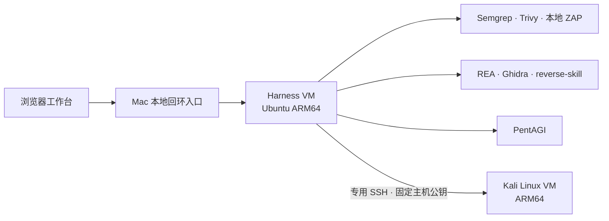

# DeepSeek Harness 网络安全版

[](https://github.com/Lushangtu123/deepseek-harness-cybersecurity/actions/workflows/verify.yml)

基于 **DeepSeek Harness + 改进版 dsh-purge + 独立 Kali Linux** 的个人网络安全工作台，面向代码审计、本地应用测试、逆向分析和安全研究。

在聊天中调用工具，在演练台中管理项目、任务、发现与证据，在 Shell 工作台中克隆和操作仓库。Harness 与 Kali 分别运行于专用虚拟机，Mac 提供本地网页入口和运维控制。

这是个人集成与改进版本。本仓库公开保存脱敏后的配置、源码、安装工具和验收资料；**克隆仓库不等于获得完整虚拟机或可直接使用的账号环境**。

## 能做什么

| 能力 | 使用方式与范围 |
| --- | --- |
| 代码与依赖审计 | Semgrep 检查代码，Trivy 检查依赖、配置和凭据痕迹；任务保留工具版本、范围与覆盖情况。 |
| 联合安全审查 | VM 可选独立预设：固定项目副本，按需选择 Semgrep、Trivy、本地 ZAP、Kali 离线 Bandit、REA 静态 JavaScript 图及隔离 PentAGI 子任务，统一任务和证据。[使用与限制](docs/joint-security-review.md)、[适配器边界](docs/managed-joint-adapters.md)。 |
| 运行应用面板 | 安全审计页明确预览、确认启动/停止、查询原请求和期限；刷新不重放。[使用说明](docs/runtime-application-panel.md)。 |
| 运行源码关联 | 明确启动标准库 Python 副本，ZAP前后核对源码/容器/转发身份；其他应用默认未证明。[使用与限制](docs/runtime-source-link.md)。 |
| 本地 Web 测试 | ZAP 接入 VM 内指定回环网址，支持命名的私有 Cookie/Bearer 会话；当前入口不接受任意公网目标。 |
| Kali 工具调用 | 聊天或 Shell 通过专用 SSH 调用独立 Kali；环境适配页显示真实工具路径与连接状态。 |
| 逆向分析 | REA、Ghidra 与 reverse-skill 提供分析入口；样本和所需工具在 VM 内准备。 |
| 智能体协作 | 集成 PentAGI 的任务入口，模型账号、服务和工作镜像需在本地配置。 |
| 项目与终端 | Shell 工作台支持 `git clone` 等命令，终端与项目管理用于查看进程、目录和工作区。 |
| 发现与报告 | 待验证、确认、误报、修复及复测记录，扫描结果对比、Markdown 报告与证据交付包。 |
| 运维与恢复 | 状态检查、SSH 诊断、工具链版本检查、漏洞库维护、容量预警及恢复点管理。 |

审计命中首先进入“待验证”。未再次命中、扫描失败或覆盖不完整，都不会直接等同于“已修复”或“安全”。

## 架构



- **Mac**：提供受管网页入口、既有代理与 VM 运维；当前部署不授予 Mac 完全访问权限。
- **Harness VM**：保存工作区、会话、审计数据与工具配置。当前个人部署允许 VM 内完全访问和自动执行；具体行为仍取决于运行模式。
- **Kali VM**：使用独立持久化系统及 `harness` 普通用户。SSH 仅使用专用密钥，校验固定主机公钥，密码远程认证关闭。

演练台的审计范围校验只覆盖对应审计入口，不能当作整个 VM 的访问控制。通用 Shell 与原版能力有各自的权限行为。切换原版能力会重启服务，并改变 VM 内提示词、权限与沙盒行为，操作前请阅读[原版能力说明](docs/original-capabilities.md)。

## 快速开始

### 查看源码与检查导出

```sh
git clone https://github.com/Lushangtu123/deepseek-harness-cybersecurity.git
cd deepseek-harness-cybersecurity
python3 -B scripts/verify_export.py
```

该检查核对文件摘要、Python/JSON 结构和固定凭据模式，不启动 VM、不调用模型，也不代表完整安全审计。

### 使用已经配置好的原 Mac 环境

双击仓库根目录的 [Harness.command](Harness.command)，回车打开合并版。进入聊天后可打开 **Shell 工作台**；进入 **dsh-purge → Drill → 安全审计** 可管理审计任务，**环境适配** 可选择远程 Kali。

启动器依赖原 Mac 已安装的控制器与 VM；它不负责在新电脑创建环境。保持 `Harness.command` 与 `scripts/` 的相对位置，菜单与操作说明见[统一启动入口](docs/launcher.md)。

### 在新环境部署

按以下顺序准备，不能在现有日常 VM 上直接运行空白安装器：

1. 准备符合本项目固定模板的 **Ubuntu 24.04 ARM64 专用 VM**、`purge` UID 1000 用户、系统依赖及宿主隔离网络，见[基础安装](docs/basic-bootstrap.md)。
2. 在该 VM 内先运行 `python3 -B scripts/bootstrap_guest.py` 查看计划；确认空白目标后，按安装文档执行显式安装。
3. 需要 REA、Ghidra、PentAGI 等专业环境时，准备另行保管的资产包及独立摘要，按[专业环境安装](docs/professional-bootstrap.md)导入。
4. 在本地配置模型账号、选择工作区，并启动需要的服务。源码和资产包都不提供旧账号、聊天或项目数据库。
5. 如需 Kali，另行准备持久化 Kali VM、专用 SSH 密钥及独立核对的主机公钥，参照[Kali 接入说明](docs/kali-connection.md)。

安装器适用于本项目的固定路径和网络模板，不是面向任意 Mac、Linux 或云服务器的一键部署程序。专业资产安装也不会自动完成模型账号配置或启动 PentAGI。

## 调用 Kali Linux

在演练台 **环境适配 → 工具执行位置** 选择“远程 Kali · 专用 SSH”，保存后查看连接和工具数量。也可在聊天中要求：

> 使用 Kali 技能，检查 Kali 状态和 Nmap 版本，不扫描目标。

在已配置的 Harness VM Shell 中：

```sh
kali-vm status
kali-vm inventory
kali-vm tool nmap --version
kali-vm tool dnsx -version -duc
kali-vm exec -- python3 --version
kali-vm shell
```

截至 **2026-11-01** 的验收记录，工具目录共 **26 项，实际找到 25 项**：

| 类别 | 已接入工具 |
| --- | --- |
| 网络与 Web 检查 | Nmap、Nuclei、Masscan、fscan、gogo、ffuf、httpx |
| DNS 与域名 | dnsx、subfinder、dig |
| 连接与隧道 | suo5、frpc、frps、chisel |
| 协议与诊断 | Impacket 入口、curl、wget、OpenSSL、tcpdump、TShark |
| Web 与文件分析 | WhatWeb、Nikto、sqlmap、file、strings |

唯一缺项为 **ksubdomain**：核对的官方 v2.4.0 发布资产没有 Linux ARM64 文件，当前未安装。新补充的 8 个 ARM64 二进制记录于[来源与摘要清单](work/harness-purge-vm/kali-tools-lock.json)，二进制本身不在 Git 中。

工具通过 Harness 内的固定入口在 Kali 中执行；缺失工具不回退到本机。输入、输出、模板和词表应使用 **Kali 内路径**，项目文件与凭据不会自动复制。25 项工具已验证版本或帮助调用，具体任务、实时抓包权限、模板及外部账号仍需分别准备。完整配置、恢复与限制见[Kali 接入说明](docs/kali-connection.md)。

当前 .6 恢复点与独立恢复磁盘已实际启动验收，保留原27点，共28点；新启动诊断、已修复的误报和私有恢复边界见[启动诊断说明](docs/startup-diagnostics.md)。Kali沿用既有已验收私有归档。

## 安全审查预检与受限预设

新聊天可选择 **安全审查 · 受限工具**，将调用限定为当前绑定项目的受管审计、有界脱敏源码读取和固定 Kali 合成验收。页面和报告新增只读覆盖清单，人工验证项保持未验证；原版模式继续保留。配置、执行边界与使用方法见[安全审查说明](docs/security-review.md)，实际模型、Chrome、原生工具边界与回归结果见[验收摘要](docs/security-review-verification.json)。

## 安全审计流程

1. **确认范围**：选择项目，填写 VM 工作区内的仓库绝对路径、工具及到期时间；本地 Web 测试另填允许的网址。
2. **提交任务**：由页面或绑定到同一项目的聊天调用 `redteam_security_audit`，通过持久任务 ID 查看进度。
3. **验证发现**：记录依据，再确认问题或标记误报；记录修复后执行复测，保留覆盖缺口。
4. **交付结果**：对比同项目的扫描观察，导出报告；需要图片附件时使用证据交付包。

连接中断或结果未确认时，页面保留提示与原请求，不自动重发写入。先核对状态，再明确决定是否重试。详细范围、状态与导出限制见[安全审计工作台](docs/security-audit.md)及[报告交付包](docs/report-export.md)。

## 仓库结构

| 路径 | 内容 |
| --- | --- |
| `guest-home/` | 脱敏后的 VM 配置、技能、服务定义、命令入口及工具调用适配。 |
| `work/harness-purge-improved/` | 改进版 dsh-purge 源码、前端构建和回归测试。 |
| `work/harness-purge-vm/` | Mac 控制器、网页入口、代理、诊断和恢复工具，以及 Kali 客户端源码。 |
| `work/toolchain-version-checker/` | REA、reverse-skill、PentAGI 固定来源的版本检查工具。 |
| `runtime-overrides/` | 修改过的官方运行时模块及其来源与许可证记录。 |
| `scripts/` | 导出校验、安装、恢复预检、维护及 CI 入口。 |
| `inventory/` | 文件摘要、脱敏范围、固定版本、镜像与资产清单。 |
| `docs/` | 使用指南、历史变更、验收证据与恢复限制。 |

## 验证与已知限制

无需 VM 和模型密钥，可在 **Python 3.13 / Node.js 24** 环境运行与 GitHub Actions 一致的检查：

```sh
python3 -B scripts/ci.py --suite all
```

检查涵盖导出完整性、Python/Node 回归和客户端重建一致性。真实 VM 启动、账号连接、模型任务和浏览器交互，需要单独验收，不能由 CI 通过推断完成。

当前个人部署运行 **dsh-purge 1.1.77-personal.9**，Kali 为 **2026.3 ARM64**。版本是部署和验收记录，不表示上游最新版本；具体来源以[导出清单](inventory/export.json)、[当前状态](docs/current-status.md)和对应验收资料为准。

- **Semgrep 仍有解析缺口**：已保留 `PartialParsing` 及相应失败状态，补充文本提示不等于完成语义分析。见[解析器自检](docs/semgrep-parser-check.md)。
- **历史连接问题未全部定位**：部分旧 SSH 失败及 QEMU 内部具体缺陷尚无确定根因，后续成功不用于改写原失败记录。见[SSH 与恢复诊断](docs/reload-recovery-ssh.md)。
- **恢复覆盖有边界**：.9 恢复点覆盖152项程序及2822项选定摘要；Kali另有本机私有归档。Mac全局标签仍旧，新点需明确私有入口；本机副本不替代异机灾备，见[当前验收](docs/runtime-application-panel-verification.json)。
- **仓库不包含整机运行资产**：VM 磁盘、恢复归档、专业二进制、容器数据、账号和凭据需独立保管；仅克隆源码无法恢复整套环境。

## 文档导航

| 主题 | 文档 |
| --- | --- |
| 部署与恢复 | [基础安装](docs/basic-bootstrap.md) · [专业环境](docs/professional-bootstrap.md) · [恢复与路径](docs/restore.md) |
| 日常使用 | [统一启动菜单](docs/launcher.md) · [原版能力](docs/original-capabilities.md) · [Kali 接入](docs/kali-connection.md) |
| 审计与交付 | [安全审计](docs/security-audit.md) · [认证 ZAP](docs/authenticated-zap.md) · [报告与附件](docs/report-export.md) · [证据保护](docs/evidence-protection.md) |
| 长任务与可靠性 | [后台审计与校时](docs/background-audits-clock.md) · [会话恢复](docs/session-lifecycle.md) · [SSH 与 PentAGI](docs/ssh-pentagi.md) |
| 工具与容量维护 | [扫描器准入](docs/scanner-admission.md) · [容量面板](docs/storage-dashboard.md) · [存储预览](docs/storage-preview.md) |
| 界面与历史验收 | [桌宠位置](docs/pet-layout.md) · [浏览器验收流程](docs/browser-acceptance.md) · [选择性稳定性更新](docs/stability-backports.md) · [验收资料目录](docs/) |

## 隐私与许可证

公开导出排除 API 密钥、SSH 私钥、主机信任文件、登录令牌、私有链接、聊天、项目数据库、运行日志、容器数据、VM 磁盘及恢复归档。模型账号、Kali 本地密码和连接凭据在本地配置，不写入 README。

第三方代码、技能与资产沿用各自许可证，本仓库不对其统一重新授权。使用和分发时请核对对应目录的许可证，包括改进版 dsh-purge 保留的 [LICENSE](work/harness-purge-improved/package/LICENSE)、[商业条款](work/harness-purge-improved/package/LICENSE-COMMERCIAL.md)与[NOTICE](work/harness-purge-improved/package/NOTICE)。
