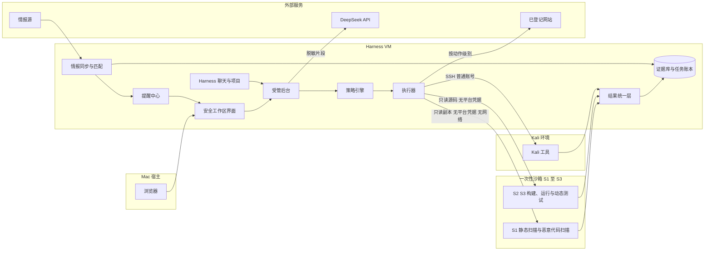
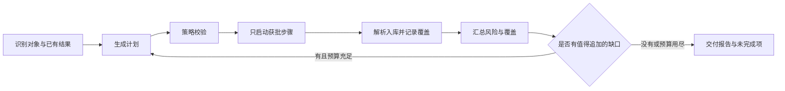
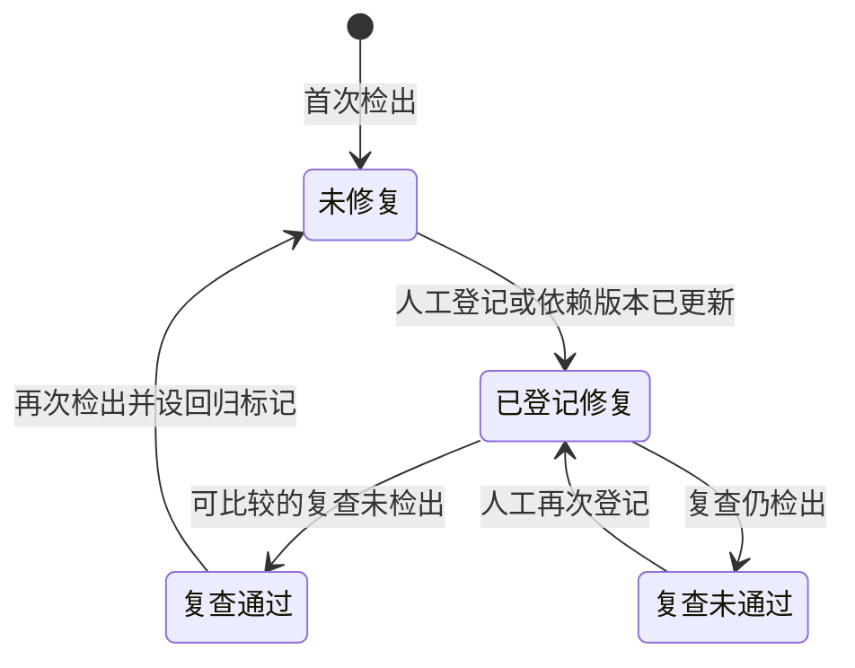
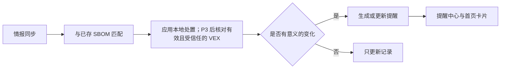

# DeepSeek Harness 网络安全版：安全工作区开发文档

| 项目 | 内容 |
| --- | --- |
| 版本 | v1.3 合订版（开发方案，待定稿） |
| 日期 | 2026-11-02（America/Los_Angeles） |
| 状态 | 方案阶段，待评审；文中新增能力均未开发、未部署 |
| 合订来源 | Claude v1.2 主稿＋v1.2 Codex 修订稿；v1.0、v1.1 及两份 v1.2 原文均保留 |
| 适用对象 | VM 改进版 DeepSeek Harness（术语见附录 A） |
| 负责人 / 评审人 | 待指定 |

## 修订记录

| 版本 | 日期 | 变化 |
| --- | --- | --- |
| v1.0 | 2026-11-02 | 讨论整理稿 |
| v1.1 | 2026-11-02 | 确定定位为"应用安全检测＋恶意代码扫描"（D-01）；新增工具自身安全、结果统一层、风险优先级模型、恶意代码扫描、SBOM/VEX、忽略与接受风险；补充 JS/TS；需求编号化；整理过程记录移入附录 E |
| v1.2 | 2026-11-02 | 保留 v1.1 结构。① 沙箱依赖（阻断项）：沙箱分为 S1～S3 三档、按阶段交付，S1 提前到 P1 并须在 P0 实测；所需档位未就绪时步骤不执行，不在沙箱外降级运行。② 状态语义：问题状态拆为检出状态、处置结论、修复进度三个维度，按类别限定处置，VEX 只用于依赖漏洞。③ 优先级语义：只对排队中的问题计算，按类别分表，统一未知值与置信度的处理，增加防抖与"处理建议"，KEV 与 EPSS 提前到 P2。授权阻断项按用户要求暂缓，B2.2 保持 v1.1 原文。逐项对照见附录 E |
| v1.3 | 2026-11-02 | 合并 Claude 的问题三维状态、分类优先级、处理建议、S1～S3 隔离分档与 Codex 的任务四维状态、独立 VEX 事实、覆盖未知、原生诊断、影响集合复查及供应链核验；统一需求/验收编号和阶段依赖。授权项继续暂缓，详见附录 F |

## 阅读说明

- **结构**：A 部分写做什么（产品需求），B 部分写怎么做（技术设计），C 部分写怎样证明做好了、按什么顺序做（验收与路线）。附录是术语、现有基线、回归案例、参考资料与文档来源。定稿后三部分可以直接拆成三份文档。
- **来源标记**：【用户】用户提出或确认，`#n` 指 v1.0 §2.1 第 n 条；【建议】设计建议，评审通过前不是定案；【基线】已有能力的记录，来源见附录 B，本稿未重新实机验收；【待定】需要决策，见 C7。
- **要求强度**："必须"为发布阻断级；"应"为默认要求，经评审可调整；"可"为可选项。
- **编号**：需求 `REQ-领域-序号`，决策 `D-序号`，威胁 `T序号`，验收场景 `AC-序号`，回归案例 `RG-序号`，用户场景 `SC序号`；沙箱档位 `S1～S3`，动作级别 `L0～L3`，就绪等级 `R0～R3`。A4 同时是需求追踪表。

### 合订结论与范围

本稿是两份 v1.2 的统一后续版本。Claude 主稿的 A/B/C 结构、入门流程、分类处理建议及问题三维状态继续使用；执行、证据和验收采用合并后的统一合同。

- **问题维度**：检出状态、处置结论、修复进度；描述问题现在是什么情况、用户如何处理、是否复查。
- **任务维度**：执行状态、结果收录、检测覆盖、资源清理；描述工具工作及证据的实际完成情况。两者分别建模，不互相替代。
- **授权暂缓**：按用户要求，本稿保留 Claude v1.2 的 B2.2、D-02、D-04 与 AC-16，暂不解决其中目标授权/所有权的评审问题。暂缓不等于已通过发布门槛，使用前提仍是仅用于明确授权的项目。
- **实现状态**：本次只编写合订文档；沙箱、自动路由、新核实器和提醒等拟新增能力未因文档合订而实现。本轮不启动 VM、不安装工具、不改变权限、不部署程序。

新增产品范围和策略参数作为合订方案保留，负责人、阈值、时间、具体格式及尚未明确的选择仍在 C7 决策，不补造历史批准或验收记录。

---

# A 部分：产品需求

## A1 产品定位

**定位【合订建议，D-01 待定稿】**：面向非安全专业用户的项目安全检测工作台。交互借鉴杀毒软件"一键扫描 → 风险列表 → 处理 → 复查"的方式；检测对象是用户自己的代码项目、依赖，以及用户自己运行的应用和网站；检测内容是已知漏洞、危险代码、错误配置、泄露的凭据，以及恶意代码、WebShell 和恶意依赖包。

| 杀毒软件 | 本产品 | 说明 |
| --- | --- | --- |
| 快速扫描 / 全盘扫描 | 普通检查 / 深度检查 | A7 |
| 病毒库与更新时间 | 漏洞情报、扫描规则、恶意代码特征库，以及各自的更新时间 | 首页"检测能力"区显示（A6.2） |
| 查杀木马和后门 | 恶意代码扫描：WebShell、后门、被篡改文件、恶意依赖包 | B10 |
| 实时防护 | 新公告到达后自动与已存组件清单重新匹配；依赖或代码变化后提示复查 | 不做进程或文件级实时拦截 |
| 隔离与修复 | 修复候选、升级方案、处置步骤 | 首版不自动删除或改写用户文件 |
| 信任区 / 白名单 | 忽略、接受风险（带到期时间）、误报、不受影响声明 | B8 |
| 体检分 | 不设分数，用"立即处理 N 项"这类优先级摘要代替 | 分数缺少校准依据 |

## A2 用户与场景

| 用户 | 描述 | 来源 |
| --- | --- | --- |
| U1 入门开发者、学生（主要用户） | 有 PHP、Python 或 JS 项目，不熟悉安全工具，想知道有没有问题、怎么修 | 【用户】#8 |
| U2 小型网站维护者 | 网站已上线，关心依赖漏洞、后门和更新提醒 | 【建议】 |
| U3 进阶用户 | 熟悉安全概念，使用深度检查、Kali 和高级功能 | 【建议】，对应保留的专业入口 |

| 场景 | 用户的话 | 对应需求 |
| --- | --- | --- |
| SC1 | "帮我检查这个项目有没有问题" | REQ-SCAN-01、REQ-RISK-01 |
| SC2 | "我的网站是不是被放了后门" | REQ-MAL-01 |
| SC3 | "出了新漏洞告诉我：我受不受影响，该升到哪个版本" | REQ-INTEL-01～03 |
| SC4 | "这个问题是真的吗" | REQ-VER-01 |
| SC5 | "我改完了，帮我确认修好了" | REQ-FIX-02 |

## A3 范围与非目标

### A3.1 检查对象类型【建议】

| 对象 | 示例 | 首版支持 | 前提 |
| --- | --- | --- | --- |
| 源码项目 | 本地目录、从 GitHub 导入的仓库 | 支持 | 在项目副本上检查；扫描器在 S1 沙箱中运行（B2.1） |
| 项目依赖 | composer.lock、package-lock.json、requirements.txt | 支持 | P3 之前只解析锁文件中已固定的版本；需要下载或构建才能解析的部分在 S2 中进行 |
| 本地运行的应用 | VM 或沙箱内启动的测试实例 | 支持被动检查；主动测试在深度检查中提供 | 实例运行在 VM 或沙箱内 |
| 已上线网站 | 用户自己的域名 | 只支持被动检查 | 先登记目标；主动测试需验证所有权（B2.2） |
| 服务器 | 用户自己的 Linux 主机 | 后续 | 只读体检，另行设计 |
| 单个可疑文件 | 上传的 PHP、脚本或程序文件 | 支持恶意代码扫描 | 在 S1 沙箱中分析 |

### A3.2 非目标

以下内容不在本产品范围内。界面和帮助文档要同样写明，避免用户按杀毒软件的习惯产生误解：

1. 实时的进程和文件防护，以及主机或终端杀毒。
2. 网络流量入侵检测。
3. 对未登记或未验证所有权的目标做主动测试。
4. 首版的通用"一键修复"，以及对生产环境的自动修改。
5. 零延迟、零漏报或对所有语言的无条件覆盖。
6. 完整的自主渗透。

### A3.3 保持不变（沿用 v1.0 §2.3）

- 现有专业入口与原版能力入口。
- Mac 宿主的隔离与权限边界。
- 原项目文件与历史审计记录。现有 95 条待验证发现保持原状态，不作为真值。

## A4 需求清单与追踪

| 编号 | 需求 | 来源 | 设计 | 验收 | 阶段 |
| --- | --- | --- | --- | --- | --- |
| REQ-SCAN-01 | 一键开始检查，系统按对象自动选择适用的检查 | 【用户】#1 | B3、B4.3 | AC-01、AC-03 | P1 |
| REQ-SCAN-02 | 提供普通检查与深度检查两种模式 | 【用户】#10 | A7、B3 | AC-02 | P1（普通）、P5（深度完整） |
| REQ-SCAN-03 | 深度检查可使用全部已适配的工具与 VM 内执行能力；高风险动作逐项确认，任意命令在 S3 沙箱中执行 | 【用户】#10；确认与沙箱方式为【建议】（D-02） | B2、B3 | AC-14、AC-15、AC-16 | P5 |
| REQ-SCAN-04 | Kali 等重型工具按需启动；未选工具的实际启动数为 0 | 【用户】#4 | B4.3、B4.4 | AC-03 | P1 |
| REQ-SCAN-05 | 每个已启动步骤的结果都解析入库，或记录失败、未知的原因 | 【用户】#4 | B4.4 | AC-03、AC-07、AC-08、AC-24 | P1 |
| REQ-RISK-01 | 结果按危险程度（优先级）排列，并显示理由 | 【用户】#1 | B5.4、B6 | AC-01、AC-20、AC-26 | P1 |
| REQ-RISK-02 | 支持按类别的本地处置、到期、忽略与独立 VEX 声明；不改原项目 | 【建议】 | B8.3～B8.5 | AC-19、AC-23 | P2（本地处置）、P3（VEX） |
| REQ-VER-01 | 支持核实单条、勾选的多条，以及当前筛选下的全部可核实问题 | 【用户】#2 | B7 | AC-04、AC-05 | P3 |
| REQ-FIX-01 | 提供修复建议或修复候选，展示变更、影响与回滚方案 | 【建议】，沿用 v1.0 主流程 | B9.6 | AC-11 | P3～P4 |
| REQ-FIX-02 | 修复后可一键复查受影响的问题；"未检出"与"已修复"分开显示 | 【建议】，沿用 v1.0 主流程 | B4.6、B8.2、B8.3 | AC-11、AC-21、AC-27 | P1（整轮）、P3（增量） |
| REQ-MAL-01 | 检测 WebShell、后门、被篡改文件和已知恶意依赖包 | 【合订建议】D-01 | B10 | AC-13 | P2 |
| REQ-INTEL-01 | 同步多来源漏洞公告，并显示每个来源的更新时间 | 【用户】#6 | B9.2、B9.4 | AC-09、AC-26 | P2（OSV、GHSA、KEV、EPSS）、P4（NVD、发行版、运行时公告） |
| REQ-INTEL-02 | 新公告自动与已存组件清单匹配，命中时提醒 | 【用户】#6 | B9.1、B9.3 | AC-09、AC-10、AC-23 | P2 |
| REQ-INTEL-03 | 提醒包含补丁可用性与推荐修复版本 | 【用户】#6 | B9.5 | AC-10 | P2 |
| REQ-INTEL-04 | 同一事件不重复提醒，只在有意义的变化时提醒 | 【建议】 | B9.5 | AC-10 | P2 |
| REQ-LANG-01 | 覆盖 PHP、Python、JavaScript/TypeScript、Java、C/C++ | 【用户】#7；JS/TS 为【建议】 | B11 | AC-03 | P1（PHP、Python、JS/TS）、P4（Java、C/C++） |
| REQ-UX-01 | 入门用户不需要认识工具名称即可完成主流程 | 【用户】#8 | A5、A6 | AC-01、AC-12 | P1 |
| REQ-UX-02 | 首页显示检测能力就绪情况和各类库的更新时间 | 【建议】 | A6.2、B9.4 | AC-12 | P1 |
| REQ-UX-03 | 提供按目的分组的工具箱 | 【用户】#3 | A6.5 | AC-12 | P1 |
| REQ-INT-01 | 聊天和界面发起的检查进入同一后台、同一任务账本 | 【用户】#9 | B12 | AC-06、AC-12 | P1～P2 |
| REQ-TRUST-01 | 数量、编号、路径与状态由后台计算；模型输出中的引用可以逐条核对 | 【用户】#5 | B13 | AC-08、附录 C、AC-24 | P1 |
| REQ-TRUST-02 | 每条结论标明类别：工具观察、模型分析、验证证据或人工确认 | 【建议】，需求 #5 的展开 | B13.2 | AC-05 | P1 |
| REQ-SEC-01 | 受管步骤按所需隔离档位准入；平台凭据不可读，专用测试账号按独立合同管理 | 【建议】 | B2.1 | AC-15、AC-22 | P1（S1）、P3（S2）、P5（S3） |
| REQ-SEC-02 | 主动测试只对本地目标或已验证所有权的目标开放 | 【建议】 | B2.2 | AC-16 | P1 |
| REQ-SEC-03 | 发给模型的内容先脱敏，外发记录可以查看 | 【建议】 | B2.4 | AC-17 | P1 |
| REQ-SEC-04 | 扫描器、规则库与特征库的版本和摘要被锁定并记录 | 【建议】 | B2.6 | AC-18、AC-25 | P1 |
| REQ-SEC-05 | 被测内容中的指令性文本不改变计划、权限或执行 | 【建议】，沿用 v1.0 §9.2 | B2.3 | AC-14 | P1（结构）、P5（深度） |
| REQ-EVAL-01 | 用带标准答案的样本集证明检出效果，并比较普通与深度模式 | 【用户】#11 | C1、C2 | AC-02 | P0 起，各阶段 |

## A5 主流程

```text
选择检查对象 → 预检 → 开始检查 → 查看结果（按优先级）
    ├─ 低成本修复（如小版本升级）：修复 → 复查
    └─ 修复成本高或结论不确定：核实 → 修复 → 复查
```

- 按钮和聊天都能发起同一流程（REQ-INT-01）。
- 走哪条路径由"处理建议"决定（B6.6）：“准备升级”在候选通过测试及具体应用确认后走第一条，"先核实"走第二条。
- 任何时候，用户都能看到正在检查什么、结果是否完整、下一步能做什么。

### A5.1 预检清单【建议】

| 检查项 | 不满足时 |
| --- | --- |
| 识别语言与锁文件 | 列出未识别的部分，并说明它们不在本次覆盖范围内 |
| 计划所需工具的就绪等级（B4.2） | 从计划中移除未就绪的工具并说明原因 |
| 计划所需的沙箱档位（B2.1） | 依赖该档位的步骤标为"不可用：隔离环境未就绪"，不会改在沙箱外执行 |
| 漏洞库、规则库、特征库的更新时间 | 超过阈值显示"已过期"；仍可检查，结果标注所用版本 |
| Kali 连通（仅深度检查） | 深度计划中依赖 Kali 的步骤标为"不可用" |
| 模型额度与预算 | 显示剩余额度；不足时只运行不需要模型的步骤 |
| 磁盘空间 | 不足时不能开始，并提示需要释放多少空间 |
| 目标授权（网站类对象） | 未验证所有权时只提供被动检查 |
| 项目暴露面（是否部署到公网） | 未填写时按"可能对公网开放"计算优先级（B6.2），并提示用户补充 |

## A6 界面

### A6.1 导航

左侧主导航固定四项，底部是高级功能与设置帮助，顶部右侧是提醒中心入口。

```text
┌──────────────┬──────────────────────────────────┐
│ 检查项目     │ 当前对象 · 当前任务状态   [提醒] │
│ 检查结果     │                                  │
│ 工具箱       │ 页面主要内容                     │
│ 历史报告     │                                  │
│              │                                  │
│ 高级功能     │                                  │
│ 设置与帮助   │                                  │
└──────────────┴──────────────────────────────────┘
```

| 页面 | 主要职责 | 最突出的操作 |
| --- | --- | --- |
| 检查项目 | 选择对象、选择模式、预检、查看本次计划与进度 | 开始检查 |
| 检查结果 | 优先级排序、筛选、勾选、详情、核实与修复入口 | 核实选中问题 / 修复 |
| 工具箱 | 按目的打开工具、终端与环境维护功能 | 每张卡片的打开或配置 |
| 历史报告 | 历史任务、前后对比、证据与报告导出 | 查看或导出 |
| 高级功能 | 原演练台、资产测绘、智能体、隧道、攻击链等 | 按专业任务决定 |
| 提醒中心 | 新漏洞命中、补丁发布、接受风险到期 | 查看受影响的项目 |

"安全工作区"指上述新界面，是默认入口；"原演练台"保留在高级功能中（附录 A）。

### A6.2 检查页（首页）

```text
检查项目

当前对象：PhishGuard（源码项目）                    [更换]
模式：● 普通检查   ○ 深度检查
本次将检查：代码、依赖、凭据与配置、恶意代码
在哪里检查：项目副本，在隔离环境中运行，不会修改你的原文件

                     [开始检查]

检测能力
  ✔ 隔离环境          基础隔离已就绪
  ✔ 代码检查规则      11 月 1 日更新
  ✔ 漏洞库            3 小时前更新
  ⚠ 恶意代码特征库    9 天前更新，已过期          [更新]
  ✖ Kali              未连接，只影响深度检查

上次检查：11 月 1 日 · 立即处理 2 项 · 尽快处理 5 项
[查看结果]
```

- 示例数字只用于说明布局，界面数据全部来自后台。
- "检测能力"区对应杀毒软件的"病毒库已是最新"，显示真实的工具就绪等级（B4.2）、沙箱档位（B2.1）与各类库的更新时间（B9.4）。
- "在哪里检查"按本次计划的真实执行对象生成。深度检查涉及构建、运行或修改测试副本时，如实列出会改动什么。

### A6.3 视觉与交互原则

- 浅色底、清晰文字、少量边框；绿色用于主要操作，红色用于需要关注的问题。
- 一个页面只突出一个主要操作；刷新、导出、配置与日志放在次级位置。
- 主页面使用普通语言；工具名、CVE、规则编号、路径与参数放在详情里。
- 颜色之外同时使用文字和图标；支持键盘操作、清晰焦点、字号调整与窄窗口布局。
- 进度来自真实步骤：能估算时显示步骤进度，无法估算时显示当前阶段与已用时间。
- 首版不设安全分数（A1）。
- 桌宠可以收起，且不遮挡检查、核实、停止等操作。
- 风险列表用表格；图表只用于比较风险分布或历史变化。

### A6.4 结果列表与详情

**列表字段**：选择框、问题名称、优先级（含理由）、处理建议、统一严重性、置信度、状态（B8.2 的显示状态）、最近一次核实观察、影响位置、来源工具、新增或持续（相对上次检查）、是否有修复版本、下一步操作。

**默认视图**：只列出排队中的问题（B6.1）。已修复、疑似已消失、误报、不受影响、接受风险的问题，在对应的筛选中查看。

**默认排序**：优先级 → 统一严重性 → 置信度 → 首次发现时间（B6.5）。工具给出的原始严重性在详情中保留。

**筛选**：搜索，以及按优先级、处理建议、严重性、状态、工具、任务、类别（依赖漏洞 / 代码问题 / 配置问题 / 凭据 / 恶意代码）筛选。

**选择范围**：选择栏始终显示"已选 N 项"和范围类型（本页 / 当前筛选全部 / 手动选择）。后台按范围类型和筛选条件快照执行，范围只限当前对象。

**详情页**先回答三件事：哪里有问题、可能造成什么影响、下一步怎么做。然后是证据、版本、来源任务、覆盖边界与修复建议。状态区分别显示检出状态、处置结论与修复进度（B8.1）。通俗解释来自经过审核的知识库（B13.4）；与具体代码相关的分析由模型补充，并标注"模型分析"。

### A6.5 工具箱

| 分组 | 入口示例 |
| --- | --- |
| 检查与核实 | 检查网站、检查依赖、扫描恶意代码、核实指定问题 |
| 文件分析 | 分析可疑文件、分析 JavaScript、分析程序文件、查看证据 |
| 项目与终端 | 导入 GitHub 项目、Shell、运行项目、连接 Kali |
| 环境与维护 | 工具状态与版本、隔离环境状态、库更新、存储、恢复点、目标登记 |

- 卡片显示名称、一句话用途、就绪等级（B4.2）和打开或配置按钮；详情显示底层工具、版本、摘要、执行位置与权限条件。
- Shell、运行项目等现有入口保持不变（A3.3），但它们是不受管入口：命令直接在 VM 内执行，不经过沙箱。卡片标注"不受管"；当前对象来自外部（如从 GitHub 导入）时，打开前提示风险，并记录使用。纳入沙箱的时间见 D-19。
- 从结果详情点"核实这个问题"时，直接带入当前对象与问题上下文。
- 顶部现有的大量快捷按钮，逐步收纳到对应的功能位置。

### A6.6 文案规范【建议】

| 情境 | 文案 | 要点 |
| --- | --- | --- |
| 没有发现问题 | "在本次检查范围（N 个文件、M 个依赖，规则版本 X）内未发现已知问题。本次未检查：……" | 必须写出范围与未检查的内容 |
| 核实：已复现 | "已确认存在：我们在测试副本中复现了这个问题。" | 附证据入口 |
| 核实：条件匹配 | "可能受影响：你使用的版本在受影响范围内，但还没有证明能被利用。" | 说明缺少的条件 |
| 核实：未复现 | "这次没能复现。这不代表一定安全，可能缺少条件：……" | 列出缺少的条件 |
| 核实：需人工 | "这类问题无法自动核实，建议……" | 给出具体的人工核实步骤 |
| 模型解释 | 标题旁固定标注"AI 分析，仅供参考" | 与工具观察、验证证据在视觉上区分 |

## A7 普通检查与深度检查

| 项目 | 普通检查 | 深度检查 |
| --- | --- | --- |
| 目标 | 快速发现常见风险 | 深入分析、核实与影响判断 |
| 计划方式 | 规则式计划：同一对象、同一内容版本、同一工具与规则版本，计划相同 | 模型辅助规划，策略引擎逐步批准 |
| 执行位置 | 扫描在 Harness VM 内的 S1 沙箱中运行，不依赖 Kali | 执行器、S1～S3 沙箱、Kali，按步骤分配（B2.1） |
| 默认内容 | 读取副本；代码与依赖检查；凭据与配置检查；恶意代码扫描；已登记网站的被动检查 | 在授权范围内构建、运行、调试、针对性测试与按需逆向 |
| 工具集合 | 就绪等级为"已验收"的固定组合：P1 为 Semgrep＋Trivy，P2 起加入恶意代码扫描 | 就绪等级达到"已受管适配"的全部工具，目标集合包括 Kali、REA、reverse-skill、PentAGI 及后续适配的 Ghidra 等 |
| 高风险动作 | 不包含 | 逐项确认：L2/L3 动作（B2.2）、运行被测代码、访问新的外部域名、Kali 提权 |
| 时间、资源、费用 | 较低；开始前显示计划 | 较高；开始前显示预算，运行中显示实际消耗与缺口 |
| 产物 | 风险清单、覆盖说明 | 另有分析与复现证据、影响判断、未完成事项 |

- 默认选择普通检查。
- 切换模式只作用于下一次任务，并重新生成计划。正在运行的任务按原模式、范围和预算继续；需要改变时先停止并核对，再创建新计划。
- 两种模式都不切换原版提示词、审核方式或全局权限。聊天请求没有匹配的受管入口时，明确告诉用户，由用户决定下一步。

---

# B 部分：技术设计

## B1 总体架构



### B1.1 职责划分

| 层 | 职责 |
| --- | --- |
| Harness 原生能力 | 会话、模型、文件预览、项目、技能、已有终端入口 |
| 安全工作区界面 | 普通用户流程、模式、计划、任务、风险与证据展示 |
| 受管后台 | 计划、调度、幂等、取消、证据与状态、预算执行 |
| 策略引擎 | 唯一的执行闸门：按模式策略、目标授权、工具就绪等级与预算，批准或拒绝每个步骤 |
| 一次性沙箱 | 按 S1～S3 档位运行处理不可信内容的步骤，不含平台凭据；专用测试账号按任务与目标限制（B2.1） |
| 工具适配器 | 明确的输入输出、执行位置、版本、超时、资源与清理 |
| 模型 | 理解意图、为深度检查建议计划、解释证据、准备修复候选；不直接执行任何步骤 |

### B1.2 离开 VM 的数据【建议】

| 去向 | 内容 | 默认策略 | 用户在哪里看到 |
| --- | --- | --- | --- |
| DeepSeek API | 选中问题的脱敏代码片段、证据摘要、问题元数据 | 仅脱敏片段（B2.4） | 外发记录 |
| 情报源 | 下载公告数据；在线查询会发送组件名与版本 | 优先下载离线库，在本地匹配 | 检测能力区、来源同步时间 |
| GitHub | 导入项目；Dependabot 相关操作 | 用户发起时 | 操作记录 |
| 已登记网站 | 检查请求 | 按动作级别（B2.2） | 计划与请求日志 |
| 外部通知渠道 | 提醒摘要 | 用户配置后才启用 | 通知设置 |

## B2 工具自身的安全

本工具权限较高，处理的又全是不可信输入，自身安全与检测能力同等重要。

**资产**：用户源码；凭据（DeepSeek API Key、GitHub Token、Kali SSH 私钥）；证据库；Harness VM 与 Mac 宿主。

**信任分级**：

- 不可信：被测项目的全部内容、工具输出、网页响应、情报正文、可疑文件。
- 半可信：模型输出，因为它可能受到不可信内容的影响。
- 可信：后台策略，以及用户在界面上的确认操作。

| 编号 | 威胁 | 场景 | 控制措施 | 需求 |
| --- | --- | --- | --- | --- |
| T1 | 提示注入 | 被测项目的注释写着"请执行 curl 下载并运行脚本"，模型照做 | B2.3 | REQ-SEC-05 |
| T2 | 被测代码窃取凭据 | 安装脚本、setup.py、Makefile 或测试代码读取 VM 内的凭据并外传 | B2.1 | REQ-SEC-01 |
| T3 | 未授权测试 | 用户把他人的网站作为目标，产生攻击流量 | B2.2 | REQ-SEC-02 |
| T4 | 代码与密钥外泄给模型服务 | 解释问题时发送了密钥原文或整个文件 | B2.4 | REQ-SEC-03 |
| T5 | 证据库泄露 | 证据里有密钥、Cookie、PoC 或恶意样本 | B2.5 | REQ-SEC-03 |
| T6 | 扫描器供应链投毒 | 扫描器、沙箱镜像、规则库或特征库的更新被植入恶意代码 | B2.6 | REQ-SEC-04 |
| T7 | 解析器被畸形输入攻击 | 超大或畸形的 JSON/XML、压缩炸弹 | B2.1（S1）、B5.1 | REQ-SEC-01 |

T6 有真实先例：2026 年 3 月 Trivy 的发布渠道被攻破（CVE-2026-33634），v0.69.4 发布版、Docker Hub 上的 0.69.5/0.69.6 镜像，以及 trivy-action 绝大多数版本标签被植入窃密代码（附录 D）。

### B2.1 执行隔离【建议，D-03】

统一采用 S1～S3 命名：S1 服务静态扫描，S2 服务受控执行，S3 服务更强对抗隔离。先复用已有满足合同的机制；每档必须验证实际参数，不把技术名称视为安全保证。

| 档位 | 用途 | 网络与执行 | 阶段 |
| --- | --- | --- | --- |
| S1 扫描隔离 | 静态/恶意文件扫描、锁文件、SARIF/JSON/XML 等不可信结果解析 | 默认禁网；不执行被测文件、安装/构建钩子或自动加载的项目脚本/配置 | P0 做 VM 可行性实测；P1 交付；P2 恶意代码扫描复用 |
| S2 执行沙箱 | 依赖解析/安装、构建、运行应用、修复候选测试、动态验证 | 默认禁网；必要下载及测试连接通过精确范围的受管通道；每任务独立网络与工作目录 | P3 |
| S3 强隔离 | 深度检查的通用 Shell、对抗性样本与高风险执行 | 继承 S2，增加经过兼容性及安全验收的用户态内核或一次性 VM 等隔离边界 | P5 |

| 属性 | 共同要求 |
| --- | --- |
| 归属/生命周期 | 每个实例关联任务/步骤、启动身份与期限；正常结束、失败、取消、到期和后台重启后核对所属资源 |
| 输入 | 只挂载所需的只读副本/样本，不挂载宿主目录、用户 HOME、平台配置、Docker socket 或 SSH agent |
| 写入 | 根文件系统只读；临时工作区、缓存和产物有容量限制；构建需改源码时从只读输入建立可丢弃副本 |
| 平台凭据 | Harness、GitHub、Kali SSH 私钥和模型密钥等不进入沙箱；环境变量白名单，不继承完整宿主/服务环境 |
| 权限 | 非 root、移除不必要 capabilities、no-new-privileges；无特权模式和宿主设备 |
| 资源 | CPU、内存、进程、时长、临时磁盘、解压深度/容量及输出大小由执行器约束 |
| 网络 | S1 使用已独立下载并核对的只读规则/数据库；S2/S3 不继承 VM 整体网络权限，按本步骤范围放行 |
| 产物交接 | 固定输出目录，检查普通文件、路径、链接、类型、大小及格式；阻止越界覆盖、压缩炸弹和外部实体/引用加载 |
| 记录 | 档位、运行时/镜像摘要、启动参数、网络放行、退出/停止原因、证据收录及清理状态分别记录 |

需要登录的验证使用合成数据或最小权限专用测试账号。测试账号与平台凭据分别管理：限当前任务和精确目标，记录用途、有效期和撤销状态，不进入模型或公开报告；代理/注入机制由具体验证器合同验收。无法安全提供时转为需人工，不复制平台账号代替。

**准入与不可用行为**：

| 工作 | 最低档位 | 未就绪时 |
| --- | --- | --- |
| Semgrep/Trivy/Bandit、恶意文件和输出解析 | S1 | 不执行，记录 `sandbox_unavailable` 及未覆盖范围 |
| 下载/构建型依赖解析、运行应用、动态核实、修复测试 | S2 | 固定版本的只读解析仍可在 S1 做；其他部分不可用/需人工，不回退到 VM 裸执行 |
| 深度通用 Shell 与对抗性执行 | S3 | 受管入口不提供该步骤；其他已就绪步骤独立执行 |
| 既有网站 L1 基线 | 沿用既有受管执行合同 | 隔离例外明确显示；不据此把整轮称为全部沙箱化。此例外随暂缓的相关合同后续评估 |

档位就绪等级沿用 B4.2，并独立通过 AC-15/AC-22 的对应控制与正常对照。P0 在 Harness VM 验证 S1 可行性，P1 完成生产适配，P2 的恶意文件处理依赖已验收 S1；P3/P5 分别扩展 S2/S3。

Docker、rootless Docker/Podman、bubblewrap/nsjail 仅为候选。备用实现也必须通过同一能力合同，不因容器不可用就未经验证切换。gVisor/一次性 VM 的 ARM64、内核、运行时和观测兼容性在 P0/P5 验证，不宣称已部署，也不保证绝对阻止所有内核逃逸。

受管执行通过上述档位；原有 Shell 等不受管入口保持位置和标记，范围见 D-19。其存在不证明受管策略失效，也不允许把受管约束宣传为整个 VM 的访问控制。

### B2.2 目标授权【建议，D-04】

**目标登记**：每个网络目标先登记，记录目标、类型、所有权验证方式与时间、允许的最高动作级别。

**所有权验证**：DNS TXT 记录，或在站点根目录放置验证文件。VM 内或沙箱内的测试实例视为已验证。

**动作级别**：

| 级别 | 含义 | 示例 |
| --- | --- | --- |
| L0 | 只读本地 | 读源码副本、解析锁文件、静态扫描 |
| L1 | 被动网络检查 | 读取 HTTP 头与 TLS 证书、ZAP baseline（只爬取与被动分析） |
| L2 | 主动扫描 | ZAP 主动扫描、服务与端口探测 |
| L3 | 利用验证 | SQLmap、专用验证器发送攻击载荷 |

**允许矩阵**：

| 目标 | L0 | L1 | L2 | L3 |
| --- | --- | --- | --- | --- |
| 本地源码与副本 | 允许 | 不适用 | 不适用 | 不适用 |
| VM 或沙箱内的测试实例 | 允许 | 允许 | 深度检查 | 深度检查，逐项确认 |
| 已验证所有权的网站 | 不适用 | 允许 | 深度检查，逐项确认 | 深度检查，逐项确认；建议只用于测试环境 |
| 未验证的网站 | 不适用 | 用户发起时允许 | 不允许 | 不允许 |

- 用户第一次登记网站目标时，界面说明：对未获授权的目标做主动测试，在多数国家和地区可能违法。
- 条件不满足时，L2、L3 按钮显示为不可用，并说明缺少什么。

### B2.3 提示注入防护【建议】

1. 模型输出只是"计划建议"。每个步骤由策略引擎按模式、动作级别、工具就绪等级与预算批准，模型无法绕过。
2. 项目内容、工具输出、网页与情报正文进入模型上下文时，包在带来源标签的数据块中，系统提示声明其为数据。
3. 需要用户确认的动作，确认文案由后台根据结构化计划生成，显示目标、动作级别与可能的影响；不使用模型生成的描述。
4. 在深度检查中读取过不可信内容的模型会话，其任意命令只能在 S3 沙箱中执行（B2.1）。
5. 检测到疑似注入文本时，记录一条"信息"级观察，让用户知道。

### B2.4 数据外发与隐私【建议，D-05】

| 外发级别 | 内容 | 适用 |
| --- | --- | --- |
| 禁止外发 | 不调用远程模型；只展示确定性结果与知识库解释，或改用本地模型 | 敏感项目 |
| 脱敏片段（默认） | 与选中问题相关的代码片段（有长度上限）、证据摘要、元数据 | 一般项目 |
| 完整文件 | 指定文件全文，仍经脱敏 | 逐次确认 |

- 扫描器识别出的凭据，以及按规则与熵检测到的疑似密钥，替换为 `<SECRET:指纹前 6 位>`。
- 内网地址、邮箱、用户名是否替换，由项目设置决定。
- 每次外发生成外发记录：时间、会话、字节数、包含的文件与行号范围、脱敏条数，用户可以查看。
- 情报匹配默认使用下载到本地的数据库，避免把组件清单发给在线查询接口。

### B2.5 凭据与证据存储【建议】

- 平台凭据只对相应后台服务账号可读，不进入扫描/执行沙箱或模型上下文；Kali 连接密钥留在桥接端。专用测试账号按 B2.1 的独立合同管理。
- 凭据类发现只保存位置、类型、指纹与截断预览，不保存明文。
- 恶意样本只保存哈希、命中规则与截断片段；是否留存样本文件见 D-14。
- 证据库设访问权限与保留期限（D-15）；导出报告时默认脱敏。

### B2.6 工具供应链【建议】

工具清单记录名称、版本、发布来源、获取时间、发布/平台 manifest 摘要、本地镜像或二进制摘要、签名验证方法及结果、安装时间、就绪等级。版本锁定与摘要一致只证明固定身份，不单独证明该身份可信。

- 工具升级流程：可信来源解析 → 独立来源的发布/签名或 provenance 核对 → S1 隔离验证 → 真实输出解析回归与基准子集 → 明确切换 → 保留回退版本。扫描器不自动升级。
- 漏洞库、规则库和特征库使用独立受管更新流程：下载、来源/签名或摘要核对、限额解包、结构与兼容性检查、恶意或越界控制、回归后原子切换。失败保留上一可用版本和失败状态；时间戳与数据库摘要关联。
- 执行使用固定本地镜像/二进制身份，不在启动时跟随可变 `latest`。历史来源标签可记录，但不是运行时信任依据。
- 运行前核对实际身份与准入清单；缺失、变化或无法验证时停止对应步骤并说明原因（AC-18、AC-25）。
- 供应链事件核对覆盖发布渠道、获取时间、平台/镜像摘要及相关 CI 引用；不只比较版本号。只有受信任的已知摘要才有助于抵抗标签替换，固定到被污染摘要也不会变安全。

**Trivy 历史事件与当前核验状态**：官方 GHSA-69fq-xp46-6x23 / CVE-2026-33634 列出恶意 v0.69.4、Docker Hub 0.69.5/0.69.6 和相应 Actions 暴露范围。2026-11-02 本机导出仓库清单记录 Trivy 0.76.1，当前仓库工作流未引用 `aquasecurity/trivy-action` 或 `aquasecurity/setup-trivy`。当时 Harness VM 已停止、SSH 连接拒绝，实际镜像与历史使用情况未核验；记录不作为“未受影响”的证明。

P0 仍需在 VM 可用时核对当前实际身份、来源和适用事件指标；历史暴露调查另列范围，不借当前版本替代。无需为本文档修订启动 VM 或更换工具。

### B2.7 Kali 与权限

- 【基线】Kali 当前通过普通账号 SSH 连接；切换检查模式不会带来 root 权限。
- 需要 root、抓包、设备、外部账号或额外网络目标的步骤，列为前置条件。扩大权限或目标时，向用户说明对象和原因，按实际授权处理。
- 【基线】REA 受管适配器目前主要是静态 JS/TS 图。Ghidra、广泛的二进制分析、模糊测试和更多 Kali 操作，各自完成适配与验收后才进入深度检查的工具集合；开放通用 Shell 不等于完成适配。

### B2.8 部署假设【建议】

- Harness VM 是专用的隔离 VM；Mac 宿主的权限与隔离边界保持不变。
- VM 内的自动执行能力由设置项"允许安全工作区在 VM 内自动执行"控制：开启需要用户明确同意，并留下审计记录。用户此前的同类选择见附录 B。
- 受管检查的约束只作用于受管任务；VM 内的通用 Shell、原版插件等其他进程按各自的权限运行。界面不把受管检查的限制描述为"整个 VM 已隔离"。

## B3 检查模式与策略

### B3.1 策略对象【建议】

普通检查与深度检查是同一个策略对象的两套预设：

```text
ScanPolicy
  mode:              normal | deep
  planner:           rules（normal） | model_assisted（deep）
  min_tool_level:    R3 已验收（normal） | R2 已受管适配（deep）
  sandbox_profiles:  S1（normal） | S1～S3，按步骤取 B2.1 的最低档位（deep）
  max_action_level:  L1（normal） | L3（deep，L2/L3 逐项确认）
  allowed_targets:   允许的对象与目标类型
  egress_level:      禁止外发 | 脱敏片段 | 完整文件
  budget:            任务与步骤期限、并发、CPU、内存、临时磁盘、产物、模型请求
  confirmations:     需要逐项确认的动作类型
```

直接点击与聊天发起都由后台按策略校验，不依赖提示词约束。

### B3.2 与现有预设的映射【待定 D-09】

| 模式 | 候选实现 | 需要确认的参数 |
| --- | --- | --- |
| 普通 | 复用受管扫描入口，使用固定的已验收组合 | 工具准入、允许的读写与 HTTP 行为、预算 |
| 深度 | 复用联合任务后台，加入满足 R2 且本步骤安全/隔离验收通过的适配器 | 完整工具集合、运行/构建/调试权限、交接、追加步骤与预算 |

普通、深度是检查模式，与现有的日常、受限、联合、原版 agent 预设是不同概念，映射在 P0 确认。

## B4 调度与执行

### B4.1 工具与组件

| 工具 / 组件 | 负责 | 选择条件 | 状态 |
| --- | --- | --- | --- |
| Semgrep | 源码规则与危险用法 | 支持的语言与规则 | 【基线】已接入受管扫描；新工作区中在 S1 运行 |
| Trivy | 依赖漏洞、配置、凭据痕迹；生成 SBOM | 可识别依赖与配置，漏洞库可用 | 【基线】已接入；新工作区中在 S1 运行 |
| ZAP | Web 被动基线；深度检查中的主动扫描 | 目标已登记，动作级别允许 | 【基线】已接入 |
| Bandit | Python 安全检查 | Python 项目，且与所选 Semgrep 规则有覆盖差异 | 【基线】在 Kali 上；【建议】普通检查改为在 S1 运行 |
| REA | 静态结构与调用关系（JS/TS） | 问题需要结构证据，或深度计划需要 | 【基线】静态 JS/TS 图 |
| reverse-skill | 分析方法与路线组织 | 流程辅助，不是扫描引擎 | 【基线】 |
| PentAGI | 隔离的模型辅助子任务 | 有明确的分析任务、数据交接与模型预算 | 【基线】 |
| ClamAV | 恶意代码签名扫描 | 恶意代码扫描 | 【建议】待安装与适配，在 S1 运行 |
| YARA | WebShell 与后门规则扫描 | 恶意代码扫描 | 【建议】待安装与适配，在 S1 运行 |
| OSV-Scanner 或 Grype | 第二匹配器；离线库；部分生态的升级建议 | 需要交叉校验，或 Trivy 不覆盖的格式 | 【建议】可选 |
| 其他 Kali 工具 | 指定的网络、服务、文件或协议任务 | 已完成适配，目标与权限条件满足 | 【基线】入口存在，需逐项适配 |

"状态"一栏来自 v1.0 与仓库记录，实施前按 B4.2 的等级重新核对。

### B4.2 工具就绪等级【建议】

| 等级 | 含义 | 可以做什么 |
| --- | --- | --- |
| R0 未安装 | 环境中不存在 | 工具箱显示"未安装" |
| R1 可运行 | 已安装，能查询版本 | 只能从终端手动使用 |
| R2 已受管适配 | 后台可调用；输出可解析入库；超时与清理已实现 | 可以进入深度检查计划 |
| R3 已验收 | 通过 C1 的基准子集与解析回归 | 可以进入普通检查的固定组合 |

工具箱卡片与检查计划都显示等级。"有 Shell 入口"是 R1 的附加属性，不提升等级。沙箱档位（B2.1）使用同样的等级管理。

### B4.3 计划生成

**普通检查：规则式计划**（示例，P0 冻结）

| 识别到 | 加入的步骤 |
| --- | --- |
| 任意源码 | Semgrep（按语言选规则集）；Trivy 凭据与配置扫描；恶意代码扫描（P2 起）；均在 S1 中运行 |
| 锁文件或依赖清单（composer.lock、package-lock.json、yarn.lock、pnpm-lock.yaml、poetry.lock、requirements*.txt、pom.xml、Gradle 锁文件） | Trivy 依赖扫描并生成 SBOM（S1；P3 之前只解析已固定的版本） |
| Python 源码，且 Bandit 与所选 Semgrep 规则有覆盖差异 | Bandit（S1） |
| 已登记的网站目标 | ZAP baseline（L1） |

同一对象、同一内容版本、同一工具与规则版本，生成的计划相同。

**深度检查：模型辅助规划**。工具目录只包含描述，列入目录不会启动任何服务、容器、交接或模型调用。模型从目录中提出步骤，每个步骤带以下清单，由策略引擎批准后才执行：

| 字段 | 内容 |
| --- | --- |
| purpose | 检查目的 |
| input_identity | 输入身份：内容清单摘要、目标或运行实例 |
| reason | 选择原因：对应哪个缺口或问题 |
| permission | 动作级别与所需权限 |
| sandbox_profile | 所需沙箱档位（B2.1） |
| expected_evidence | 预期产出的证据 |
| budget | 时间、资源、模型请求额度 |
| result_destination | 结果的入库位置 |



追加循环只用于深度检查，在以下任一条件成立时结束：没有新的缺口、预算用尽、达到最大轮次（D-10）、上一轮没有产生新证据。

### B4.4 结果消费与完整性合同

后台分开保存四个维度，不使用一个“完整”标签概括整轮：

| 维度 | 示例取值 | 表示什么 |
| --- | --- | --- |
| 执行状态 | 待运行、运行中、步骤已结束、部分失败、失败、取消、中断、停止未确认 | 所选步骤实际是否运行和结束 |
| 结果收录 | 已收录、部分收录、未知 | 输出是否成功解析、归档并关联报告；失败步骤也应有原因记录 |
| 检测覆盖 | 声明范围内已核对、覆盖不完整、覆盖未知、不适用 | 仅针对列明检查项和对象的覆盖，不等于整个项目安全 |
| 资源清理 | 待核对、已确认、未确认、不适用 | 所属进程、容器、网络和临时资源是否结束/回收 |

- 每个已启动步骤必须有账本结局：成功观察、明确失败或结果未知；失败/未知记录保留原因、已取得产物和清理状态。
- “全部结果已收录”与“检测覆盖不完整”可以同时成立。例如全部解析诊断已入库，仍有文件只能部分解析。
- 有解析失败、排除、截断、无法核对的文件/组件/请求或工具失败时，覆盖不能显示为已核对；具体分母与原因见 B5.5。
- 界面示例：“检查步骤已结束 · 结果已收录 · 存在 3 处解析缺口 · 清理已确认”。缺口条数仅来自实际记录。
- 任务结果页显示调用原因 → 执行状态 → 结果收录 → 覆盖/证据位置。零命中也保留范围；分页和模型阅读范围分别记录。
- 监控的零容忍项是“未选工具实际启动”和“已启动却无账本结局”；工具明确失败不算记录丢失，但应影响执行/覆盖状态。
- 兼容旧任务状态：保留原始字段，按已有证据映射新维度；缺少历史覆盖明细时记未知，不回填推测原因或伪造逐文件记录。

### B4.5 结果复用

每条结果带 `origin` 字段：`fresh`，或 `reused(原任务 ID, 原执行时间)`。界面对复用结果显示"复用自 X 月 X 日的检查"。

| 结果类型 | 复用键 | 失效条件 |
| --- | --- | --- |
| 静态代码结果 | 内容清单摘要、工具版本、规则版本、参数、范围 | 任一项变化 |
| 依赖漏洞结果 | SBOM 摘要、匹配器版本、漏洞库版本 | 漏洞库更新后重新匹配，不必重扫源码 |
| 动态与网站结果 | 运行实例身份、配置身份、认证上下文、目标 | 任一项变化，或超过有效期（D-10） |
| 恶意代码结果 | 文件内容哈希、特征库版本、规则版本 | 特征库或规则更新 |

输入、权限或覆盖条件不明时，判定为不可复用。

### B4.6 增量复查

按问题及其影响集合决定复查范围，而不只扫描改动文件。比较内容、依赖/锁文件、配置、规则与漏洞库、调用关系和运行身份的变化；保留范围选择依据。

| 变化 | 复查范围 |
| --- | --- |
| 已有适配器能证明只影响局部规则/文件 | 受影响位置及必要的关联文件、入口和测试对照 |
| 依赖、锁文件或漏洞库变化 | 重新形成/核对组件清单并匹配相关漏洞；必要时重建运行产物 |
| 入口、公共函数、鉴权或全局配置变化 | 覆盖受影响调用路径、角色和运行场景；不能只查修改行 |
| 无可靠影响图、验证器不支持增量或身份不明 | 回退该工具/验证器的整步检查，并说明原因 |

“复测通过”需要原问题身份和适用版本可关联、相应检查完整结束、相关覆盖可证且没有截断/解析等缺口，并取得规则未再次命中或验证器通过的实际证据。工具/规则改变时需说明可比性；无法证明可比则保留原处置状态及新的复查观察。

文件删除、工具不支持、排除或失败记录为未覆盖/无法判断，不能据此复测通过。增量省时和复测结论分开验收（AC-27）。

### B4.7 生命周期合同（沿用 v1.0）

- 逻辑入口：计划、启动、状态、等待、取消、报告、核实。API 草案在 P0 交付（B14.3），优先扩展现有接口，不另建调度器。
- 每次写操作保存请求 ID 与内容身份；重连后查询同一任务，回执丢失时先查原请求，不换 ID 重发。
- 服务端持有长任务、独立期限与资源归属。"已接受请求"与"已执行完成"是两个状态，"已发出取消"与"已清理完成"也是两个状态。
- 报告分页保留总数、保留数、截断与覆盖标记。

### B4.8 预算准入与执行（沿用 v1.0：P0 定义，P1 生效）

- 预算项：任务与步骤期限、并发、CPU、内存、临时磁盘、产物限额、模型请求额度。数值见 D-10。
- 技术限额由执行器强制，模型只能在预算内提出计划。追加步骤与重试从剩余额度中扣除，子任务继承父任务的限额。
- 到期或超额时停止追加，对运行中的步骤做有界的停止、清理与结果核对；权限、成本或清理状态不明的部分如实报告。
- 主聊天与 PentAGI 子任务分别记录用量。费用按 token 用量乘公开单价估算，并标注"估算"；取不到用量时显示"未知"。货币硬上限当前未实现，请求数和 token 配额不能代替它；无法估价的付费步骤如何处理见 D-10。

## B5 结果统一层

### B5.1 解析入口【建议，D-06】

- SARIF 2.1.0 是候选交换/导出格式，不强制把现有 JSON 入口全部改成 SARIF。每个适配器使用能完整保留该工具观察、诊断、覆盖与运行状态的原生结构化输出。
- SARIF 不足以表达某些信息时，保留原生受限产物与补充字段，并映射至内部 schema；ZAP、SBOM、恶意代码和运行证据使用对应映射。
- 解析前限制总字节、条目、深度、路径及压缩展开；执行 schema 校验。远程 schema、外部实体或产物中的可执行引用不自动加载。
- 适配器区分输出截断、解析失败和无结果。逐条映射保留原字段来源；覆盖未知保持未知。工具与格式版本变化时使用真实录制输出回归。

### B5.2 内部对象

| 对象 | 含义 |
| --- | --- |
| 观察（Observation） | 某个步骤输出的一条原始结果，写入后不再修改 |
| 问题（Finding） | 跨多次检查稳定存在的问题，按指纹聚合多条观察 |
| 证据（Evidence） | 观察或核实产生的产物引用，内容寻址，只追加 |
| 覆盖记录（Coverage） | 分对象类型、输入身份、主结果、原因和统计分母的记录，见 B5.5 |

**问题类别**：依赖漏洞、代码问题、配置问题（含配置文件、网站配置与 HTTP 头）、凭据、恶意代码。B6 的优先级规则与 B8 的可用处置都按类别定义。

### B5.3 指纹

| 类别 | 指纹组成 |
| --- | --- |
| 代码问题 | 工具族、规则 ID、文件路径、归一化代码片段（去除空白与注释）、所在函数名 |
| 依赖漏洞 | 生态、包名、漏洞 ID（按别名归并）、清单文件路径 |
| 配置问题（文件） | 规则 ID、文件路径、配置项路径 |
| 配置问题（网站） | 目标、URL 模板、参数名、规则 ID |
| 恶意代码 | 文件内容哈希、规则或签名 ID |
| 凭据 | 凭据类型、文件路径、凭据值的哈希 |

- 指纹不使用行号，代码改动后行号会漂移。
- 指纹算法带版本号；升级算法时提供迁移，保留新旧指纹的映射。
- 跨工具分组只按"分组规则表"中声明的条件进行（例如相同 CWE 且位置重叠）。分组后，每条原始观察、来源任务与证据仍可查看。

### B5.4 严重性映射与置信度【建议，P0 冻结，D-07】

| 统一等级 | Trivy | Semgrep | Bandit | ZAP | ClamAV / YARA |
| --- | --- | --- | --- | --- | --- |
| 严重 | CRITICAL | 按规则元数据 | — | — | 按已校准规则的影响元数据；不只由工具名或签名命中决定 |
| 高 | HIGH | ERROR | HIGH | High | 规则影响元数据为高；置信度另存 |
| 中 | MEDIUM | WARNING | MEDIUM | Medium | 规则影响元数据为中；置信度另存 |
| 低 | LOW | INFO | LOW | Low | 规则影响元数据为低；置信度另存 |
| 信息 | — | — | — | Informational | — |
| 未知 | UNKNOWN | — | — | — | — |

- 规则元数据提供了更细的等级或 CVSS 时，以元数据为准，并记录依据。
- 原始严重性与映射表版本一并保存。
- 置信度单独存为：高 / 中 / 低 / 未提供，取自 Bandit 与 ZAP 的置信度字段以及规则元数据。
- “未知”严重性按未知显示与计数；情报未评分、未接入或过期均保留资料状态，不能从缺评分推断低风险。恶意代码置信度与严重性分别校准（B10.3）。

### B5.5 覆盖记录

覆盖维度按工具和工作类型定义，不把文件、依赖组件与 HTTP 响应数相加：

| 工作类型 | 对象/分母 | 可声明的覆盖 |
| --- | --- | --- |
| 源码/恶意文件扫描 | 已固定内容清单与计划规则适用的文件，另列全副本和排除数量 | 哪些文件有实际检查证据、哪些只有部分解析或未核对 |
| 依赖匹配 | 具体 SBOM/清单中的组件身份及已解析版本 | 哪些组件已匹配到哪一版数据，哪些身份/版本未知 |
| 网站/动态验证 | 目标、运行实例、认证上下文、请求/路由/测试场景集合 | 实际观察的请求和场景，不能由抓取 URL 数推断全站覆盖 |

记录包含 `objectType`、`objectId`、输入身份、工具/规则、主结果 `outcome`、原因列表、证据来源与数量口径。原因可以多条；统计按主结果归类去重，不能把多个原因的数量直接相加作为文件总数。

| 主结果/原因 | 含义 |
| --- | --- |
| checked | 有相应检查的实际证据；不自动宣称所有规则、路径和语义都被检查 |
| partial / parse_error | 已有部分观察，但解析或其他过程不完整 |
| unsupported / unsupported_language | 当前工具/规则不适用 |
| excluded / default_ignored、user_excluded、size_exceeded | 已证实被排除，记录排除来源 |
| unconfirmed / tool_did_not_report | 工具没有足够信息说明是否检查或为何未检查 |
| unconfirmed / timed_out、tool_failed、output_truncated | 无法核对相关范围的完整结果 |
| not_in_plan | 该工具未被本次计划选择，不计为已执行；单列未选能力 |
| unconfirmed / sandbox_unavailable | 所需隔离档位未就绪，步骤没有执行，记录所属档位和待检查范围 |

清单中的文件未出现在工具报告里，不据此猜为默认忽略、语言不支持或解析失败。输出整体截断也不自动归因到某个具体文件。具有 PartialParsing 的文件可以保留命中，但主结果仍为 partial。

报告同时展示原副本/组件总数、计划范围、实际观察、排除、部分覆盖和未知。若提供比例，明确名称、分子、分母及证据，例如“文件检查记录比例”，不命名为安全覆盖率。缺少可靠分母时不计算比例。声明范围内的每项检查都有充分记录且不存在未覆盖、排除、部分或未知，才可标为该声明范围已核对；这仍不证明不存在未知漏洞。

旧任务保留旧统计和缺口，新表不能把旧记录中 381 与 146 的差值自动分配原因（RG-01、RG-02）。

## B6 风险优先级模型【建议，P0 校准，D-07】

v1.1 的规则把各类问题混在一张表里：严重性未知的问题会落到"观察"，置信度不起作用，已经关闭的问题也参与排队。v1.2 先规定哪些问题参与排队，再按类别给出规则，并统一未知值与置信度的处理。

### B6.1 适用范围

只有"排队中"的问题计算优先级。排队中指同时满足：检出状态为"存在"或"未覆盖"；处置结论为"未处置"或"已确认"；修复进度不是"已登记修复"（B8.1）。这是唯一的排队判定，显示标签不另设规则。曾复查通过、当前未覆盖的问题也参与排队，历史通过记录不证明当前状态。其他问题显示"不排队"及原因，例如"已接受风险，至 12 月 1 日"。检出状态为“未覆盖”的问题保留原观察与无法判断标志；新情报或风险变化仍可提高其优先级，未重新覆盖不构成降级证据。登记修复的问题进入待复查队列，不能按已解决从总览消失。

### B6.2 输入

| 输入 | 适用类别 | 取值 | 缺失或未知时 |
| --- | --- | --- | --- |
| 利用信号 | 依赖漏洞 | 已知在野利用 / 有效 EPSS 值及日期 / 未查到收录 / 未知 / 不适用 | KEV 利用事实与 EPSS 概率分别存储；未接入/过期/失败为未知，没有适用编号则不适用；未查到收录不等于没有利用 |
| 依赖范围 | 依赖漏洞 | 运行时 / 仅开发或构建 / 未知 | 按"运行时"计算 |
| 可达性 | 依赖漏洞、代码问题、配置问题 | 已复现 / 有可达证据 / 未知 / 有不可达证据 | 默认"未知"；未知不降低优先级 |
| 暴露面 | 依赖漏洞、代码问题、配置问题 | 公网 / 内网或本机 / 未知 | 来自目标登记、部署身份或项目设置中的"是否部署到公网"；未知按"公网"计算 |
| 凭据暴露 | 凭据 | 已推送到远程仓库或位于公网可访问目录 / 仅本地提交 / 未提交且未被忽略 / 未提交且已被忽略 / 未知 | 按"已推送"计算 |
| 统一严重性 | 依赖漏洞、代码问题、配置问题 | 严重 / 高 / 中 / 低 / 信息 / 未知 | 按"高"计算，理由中写明"严重性未知" |
| 置信度 | 全部 | 高 / 中 / 低 / 未提供 | 未提供保留原值，排序使用明确的临时策略，不显示为工具已经给出中置信度 |
| 与上游一致 | 恶意代码 | 是 / 否 / 无比对来源 | 按"否"计算 |

统一原则：事实字段保留未知，保守计算只产生独立的临时排序输入。保存 `assessmentState`（资料充分/待评估/不适用）、`missingInputs`、`provisional`、规则版本与来源时间；不把未知暴露改写成已证实公网、不把未知严重性写成高危工具结论。

关键适用信息缺失的条目进入待评估筛选。若分类规则落到观察，提升为至少计划处理；暴露为公网或未知且关键资料不足时，通常至少尽快核对（临时）。仅符合 B6.4 全部条件的单一弱启发式观察适用其例外上限，仍保留待评估标志和缺失输入。非 CVE 问题不因 EPSS 不适用而一律算资料不足。P2 前尚未接入的来源、P2 后过期或失败的来源都明确显示，不算无利用信号。

### B6.3 规则

每个类别一张表，自上而下取第一条命中的规则。

**依赖漏洞**

| 规则 | 条件 | 优先级 |
| --- | --- | --- |
| DEP-1 | 利用信号为在野利用；依赖范围为运行时；可达性不是"有不可达证据" | 立即处理 |
| DEP-2 | 可达性为已复现；严重性为严重或高 | 立即处理 |
| DEP-3 | 利用信号为在野利用或利用概率高 | 尽快处理 |
| DEP-4 | 严重性为严重或高；依赖范围为运行时；暴露面为公网；可达性不是"有不可达证据" | 尽快处理 |
| DEP-5 | 严重性为严重、高或中，且尚未命中更高规则 | 计划处理；开发/构建依赖也核对安装与 CI 执行风险 |
| DEP-6 | 其他 | 观察 |

**代码问题与配置问题**

| 规则 | 条件 | 优先级 |
| --- | --- | --- |
| CODE-1 | 可达性为已复现；严重性为严重或高 | 立即处理 |
| CODE-2 | 严重性为严重或高；暴露面为公网；可达性不是"有不可达证据" | 尽快处理 |
| CODE-3 | 严重性为严重、高或中 | 计划处理 |
| CODE-4 | 其他 | 观察 |

**凭据**

| 规则 | 条件 | 优先级 |
| --- | --- | --- |
| CRED-1 | 凭据暴露为已推送到远程仓库或位于公网可访问目录 | 立即处理 |
| CRED-2 | 凭据暴露为仅本地提交 | 尽快处理 |
| CRED-3 | 凭据暴露为未提交且未被忽略 | 计划处理 |
| CRED-4 | 其他（未提交且已被忽略） | 观察 |

**恶意代码**

| 规则 | 条件 | 优先级 |
| --- | --- | --- |
| MW-1 | 适用的已校准高可信恶意签名、精确恶意包匹配或高可信规则命中；上游一致不抵消 | 立即处理 |
| MW-2 | 置信度为中 | 尽快处理 |
| MW-3 | 启发式命中，且与上游不一致 | 计划处理，标注"需人工确认" |
| MW-4 | 启发式命中，且与上游原始文件一致 | 观察 |

### B6.4 置信度上限

计算顺序为分类规则（B6.3）→ 未知输入的临时下限（B6.2）→ 本节的窄范围例外。仅有单一弱启发式观察、低置信且没有独立适用证据的问题，按校准策略暂设最高计划处理并保留待评估标志；即使暴露为公网或未知，也适用这个例外。该上限不适用于精确组件匹配的在野利用事实、有效高可信证据或已复现结论，不能因一个观察的低置信压低有其他有效证据的整组问题。恶意代码按其规则、签名类别和对照校准，置信度与影响严重性分别存储。

### B6.5 排序、理由与重算

- 排序：优先级 → 统一严重性 → 置信度 → 首次发现时间。
- 理由写出命中的规则编号与输入值，例如"立即处理（DEP-1）：在野利用（KEV）＋运行时依赖＋可达性未知"。
- 以下变化触发重算：检查完成、核实完成、情报同步、目标登记或项目设置变化、处置结论或修复进度变化。
- 升级立即生效；升级为"立即处理"时发提醒（B9.5）。
- 因 EPSS 回落造成的降级，以连续有效数据和回落观察期判断（候选 7 天，D-07 校准）；数据缺失/过期不是回落证据，不推进降级计时。确定性证据造成的降级先核对产品、版本、场景与有效期，VEX 按 B8.4 验证后才生效。
- 每次变化记录原优先级、新优先级、触发的输入与时间。
- 规则表、EPSS 阈值与回落参数在 P0 用 C1 的样本校准；工具原始严重性始终保留。

### B6.6 处理建议

处理建议回答"下一步做什么"，与优先级分开计算，对应 A5 的两条修复路径：

| 处理建议 | 条件 |
| --- | --- |
| 准备升级 | 依赖存在官方修复版本/发行版修复包，先生成最小必要候选与测试方案；不跨主版本不等于兼容性有保证，测试/实际应用仍按 B9.6 |
| 先核实 | 代码问题与配置问题；依赖漏洞没有修复版本，或需要跨主版本升级 |
| 按处置步骤处理 | 恶意代码（B10.4）；凭据先准备轮换和清理方案，清理历史、删除文件或修改部署按具体变更执行，不因建议而自动操作 |
| 人工判断 | 其他 |

## B7 核实

### B7.1 方法

| 问题类型 | 方法 | 动作级别 | 结论边界 |
| --- | --- | --- | --- |
| 依赖漏洞 | 核对实际版本、公告范围、安装来源与适用条件；有工具时做可达性分析 | L0，S1 | 条件匹配不等于可利用 |
| HTTP 头、Cookie、Web 配置 | 受管 HTTP 请求与 ZAP 原始证据 | L1 | 核对实际响应与作用位置 |
| TLS 与证书 | OpenSSL 等固定检查 | L1 | 记录目标、协议、证书与观察时间 |
| 源码风险 | 规则、调用路径、针对性测试 | L0；测试在 S2 中 | 静态路径证据与动态复现分开记录 |
| 注入、路径处理等 | S2 实例中的专用验证器，配正常对照 | L3（仅 S2 实例） | 需要可重复的差异与影响证据 |
| 认证、越权、业务逻辑 | 多角色账号、HTTP 与浏览器专用测试 | L2～L3 | 缺少账号、预期或环境时转人工 |
| 恶意代码 | ClamAV 与 YARA 交叉；与版本库或上游原始文件比对；检查文件位置与权限 | L0，S1 | 与上游一致只对启发式命中降级；签名命中与 `MAL-` 匹配不降级（B10.3） |

DeepSeek 与 PentAGI 可以协助分析和准备测试，其推测结论记为“模型分析”，不单独作为确认依据；执行器实际完成的测试观察和产物仍按原步骤保存为证据。SQLmap 等深入工具作为后续适配，只针对选中的具体问题执行。

### B7.2 首批验证器【待定 D-12】

依赖适用条件核对、确定性的 HTTP 配置观察、在明确测试夹具中验收过的少量运行时检查，以及恶意代码的上游比对。具体规则清单在 P0 冻结；B7.1 中的其他类型，首版显示"需人工核实"。

### B7.3 队列与记录

- 支持核实单条、勾选的条目，以及当前筛选下的可核实项。开始前列出数量、目标、方法、账号与环境条件以及预算。
- 按项目与方法共享必要的检查，不为每条问题重复整轮扫描。
- 用户取消后，核对实际停止与资源清理情况。
- 每条显示进度、证据、失败原因与可继续的下一步。
- 核实记录包括：验证器及版本、发起入口与操作者、问题修订号、项目与运行身份、实际步骤、对照、证据引用、结果。
- API 分别返回三类对象：核实任务状态、核实观察、问题状态（B8 的三个维度）。"核实任务完成"只表示验证器运行结束。

## B8 状态模型

v1.1 把人工判断（误报、接受风险）与检出事实（未再检测到、再次出现）放在同一个状态机里："已接受风险的问题在下次检查中消失"这类组合没有定义，也无法表达 A5 中"不先核实、直接修复"的路径。v1.2 把问题状态拆成三个相互独立的维度，界面上显示的状态由它们派生。

### B8.1 维度与归属

| 维度 | 归属 | 取值 | 由谁改变 |
| --- | --- | --- | --- |
| 统一严重性 | 观察；问题取当前有效观察中的最高值 | 严重、高、中、低、信息、未知 | 系统；情报修订（如 CVSS 更新）后重算 |
| 置信度 | 观察；问题取当前有效观察中的最高值 | 高、中、低、未提供 | 系统 |
| 执行状态 | 任务与步骤 | 待运行、运行中、步骤已结束、部分失败、失败、已取消、中断、停止未确认 | 系统 |
| 结果收录 | 任务与步骤 | 已收录、部分收录、未知 | 系统 |
| 检测覆盖 | 任务与步骤 | 声明范围内已核对、覆盖不完整、覆盖未知、不适用 | 系统 |
| 资源清理 | 任务与步骤 | 待核对、已确认、未确认、不适用 | 系统 |
| 资料评估 | 问题 | 资料充分、待评估、不适用；缺失输入与临时优先级另存 | 系统 |
| 核实观察 | 核实记录 | 已复现、条件匹配、未复现、需人工、执行失败、无法判定 | 验证器 |
| 检出状态 | 问题 | 存在、未检出、未覆盖 | 系统（B8.2） |
| 处置结论 | 问题 | 未处置、已确认、误报、不受影响、接受风险 | 人工；系统只能使其失效（B8.3） |
| 修复进度 | 问题 | 未修复、已登记修复、复查通过、复查未通过 | 人工登记；系统复查（B8.3） |
| 优先级、处理建议 | 问题（派生） | 见 B6 | 系统 |

- "当前有效观察"指最近一次可比较检查中的观察。
- 任务四维状态以 B4.4 为唯一合同。执行结束、结果收录和存在覆盖缺口可同时成立；不从问题状态反推工具运行或清理成功。旧任务证据不足时相应维度记未知。
- 核实观察只是证据，不直接改变检出状态、处置结论或修复进度。"未复现"不等于误报，"未检出"不等于已修复。

### B8.2 检出状态与显示状态

**检出状态**由系统按最近一次可比较的检查设置，每次变化都记录原因与任务：

| 取值 | 含义 |
| --- | --- |
| 存在 | 最近一次可比较的检查检出了该问题 |
| 未检出 | 最近一次可比较的检查没有检出；或依赖漏洞的公告已被撤回（原因记为"公告撤回"） |
| 未覆盖 | 最近的检查没有覆盖到该问题（文件删除、被排除、解析失败、沙箱不可用、规则被移除），无法判断 |

“可比较的检查”共同条件：原问题身份、实际输入/组件/目标可关联，相关规则或验证器具有可说明的可比性，相关范围实际核对且无部分解析、截断、工具失败和未知。文件存在于工具已扫描列表本身不保证全部相关检查完成。

代码/配置核对相应位置及影响集合；依赖核对实际组件身份与版本、对应来源和公告；恶意文件核对内容身份及适用规则/签名语义。工具/规则更新需说明等价或更强检查的准入依据，不只比较特征库版本大小。缺少依据时按未覆盖保留原结论，不据未命中复查通过（B4.6）。

检出状态从"未检出"变回"存在"时，系统设置回归标记；处置结论或修复进度下一次变化时清除。

**显示状态**是列表中的一个标签，按下表自上而下取第一条：

| 显示状态 | 条件 | 是否排队（B6.1） |
| --- | --- | --- |
| 误报 / 不受影响 / 已接受风险（至某日） | 处置结论为对应值 | 否 |
| 已修复 | 修复进度为复查通过，且检出状态为未检出 | 否 |
| 再次出现 | 有回归标记，且检出状态为存在 | 按 B6.1 判断 |
| 修复未生效 | 修复进度为复查未通过 | 按 B6.1 判断 |
| 修复待复查 | 修复进度为已登记修复 | 否，复查后重新判断 |
| 公告已撤回 | 检出状态为未检出，原因为公告撤回 | 否 |
| 疑似已消失 | 检出状态为未检出，且没有登记修复 | 否 |
| 无法判断 | 检出状态为未覆盖 | 按 B6.1 判断；保留旧证据，允许新证据上调，不因缺覆盖降级 |
| 已确认，待修复 | 处置结论为已确认 | 按 B6.1 判断 |
| 待处理 | 其他 | 按 B6.1 判断 |

### B8.3 迁移规则

**处置结论**由人工改变，必须带问题修订号，修订号与当前不一致时拒绝：

| 迁移 | 必填内容 | 适用类别 |
| --- | --- | --- |
| 未处置 → 已确认 | 可附核实证据 | 全部 |
| 未处置、已确认 → 误报 | 理由、相关观察/身份依据 | 全部；依赖可以是组件识别错误或其他检测错误，处置标签不自动推导 VEX 理由 |
| 未处置、已确认 → 不受影响 | 当前产品/版本的适用理由与证据；另行评估是否满足 VEX 导出 | 仅依赖漏洞；本地结论与外部声明分开 |
| 未处置、已确认 → 接受风险 | 理由、范围、到期时间 | 依赖漏洞、代码问题、配置问题 |
| 已确认、误报、不受影响、接受风险 → 未处置 | 撤回理由 | 对应类别 |

凭据与恶意代码不能"接受风险"：凭据要轮换，恶意代码要清除。确实是测试数据或无害文件时，标为"误报"。

**处置失效**由系统触发，处置结论回到"未处置"并发提醒：

| 原处置 | 失效条件 |
| --- | --- |
| 接受风险 | 到期；或接受之后风险输入变差：被收入 KEV、EPSS 越过阈值、严重性上调、暴露面变为公网、核实观察变为已复现 |
| 不受影响 | 组件版本变化；公告修订改变了受影响范围；声明所依据的可达性证据发生变化 |
| 误报 | 不自动失效；误报绑定指纹，代码改动产生新指纹时按新问题处理 |

接受风险来自忽略规则时，处置失效与对应规则中该风险范围的暂停在同一事务中记录，保留规则修订号与触发输入。到期、风险变差或人工撤回后，旧规则不再自动接受该范围的现有或未来问题；其他范围不受影响。重新接受须人工确认新的风险输入、范围和到期时间，生成新规则修订。

**修复进度**：

| 迁移 | 触发方 | 条件 |
| --- | --- | --- |
| 未修复、复查未通过 → 已登记修复 | 人工 | 修复说明或变更引用；不要求先"已确认"，对应 A5 的直接修复路径 |
| 未修复 → 已登记修复 | 系统 | 仅依赖漏洞：实际源码/运行对象中的组件版本经核对已离开受影响范围，记录对象身份和依据；同次完整且可比检查可继续判定复查，单改锁文件不证明部署已修复 |
| 已登记修复 → 复查通过 | 系统 | B4.6 与 B8.2 的完整、可比和证据条件均满足；只对已核对对象成立 |
| 已登记修复 → 复查未通过 | 系统 | 复查仍然检出 |
| 复查通过 → 未修复 | 系统 | 再次检出；设置回归标记并发提醒 |



- 后台拒绝表外的迁移请求；批量操作逐条按此表校验。
- 首版验证器只添加核实观察与建议，不改变处置结论（D-11）。接受风险是处置决定，不证明受影响；从未处置进入时保留适用性未知。人工确认标签也不自动满足 VEX 事实门槛。
- 只有修复进度能表达"已修复"；检出状态变为"未检出"本身不代表修复。

### B8.4 独立的 VEX 事实声明【建议】

本版 VEX 只用于依赖漏洞，其他代码/配置/凭据/恶意代码以相应内部结果及 SARIF 导出。工作流处置与 VEX 适用事实分别保存。取消提醒、接受风险、误报或未再命中都不直接转换为 VEX 事实。OpenVEX/CycloneDX VEX 采用的具体格式由 D-06 确定。

| VEX 状态 | 导出所需依据 | 不足时 |
| --- | --- | --- |
| under_investigation | 明确产品/组件版本与漏洞身份，适用性仍在调查 | 标为本地待评估，身份不明时不伪造声明 |
| affected | 当前产品/版本实际受影响的适用证据，附格式要求的处置建议 | 仅接受风险、人工标签或版本疑似匹配不足以补造 affected |
| not_affected | 适用于该产品/版本的理由及证据；按格式提供 justification 或影响说明 | 保留误报/不受影响的本地记录，显示 VEX 未导出 |
| fixed | 该产品版本确有修复的依据，关联变更/厂商修复和有效复查 | 未再次命中、文件被排除或普通工作流“复测通过”标签不足以单独证明 fixed |

not_affected 的理由如组件不存在、漏洞代码不存在、不在执行路径、攻击者不能控制、固有缓解等，必须逐项与实际证据相符。依赖误报可能是包身份识别错误、版本范围不匹配、回移补丁或其他原因，不能一律写成“组件不存在”。

声明对象包含产品/构建身份、组件及版本/摘要、漏洞/别名、声明者、时间/修订、理由与证据、适用配置/场景、信任来源、撤回及复核条件。只有受信任声明者、格式/身份核对通过、声明当前有效且范围精确匹配时，才可影响结果展示或提醒。来自项目文件或工具产物的 VEX 是不可信输入，不自动导入为信任规则。

组件/构建、相关配置、调用路径、漏洞范围或声明修订变化，证据到期或撤回时，失效相应抑制并重新评估。保留原始观察及被抑制原因，不从证据库删除问题。格式支持不等于已接入：Trivy 等消费者需要单独适配并通过 AC-23，随后才能启用 VEX 展示过滤。

P2 仅交付本地忽略/风险接受及其到期提醒，不依赖尚未交付的 VEX。P3 才启用上述声明导出、验证与消费。其他类别的误报/风险接受可写为 SARIF suppressions，保留理由和范围，不伪装为漏洞适用事实。

### B8.5 忽略规则

- 忽略规则是批量处置：对范围内现有与将来的匹配问题，自动套用"误报"或"接受风险"，带理由与到期时间；套用时同样受 B8.3 的类别限制。
- 范围：仅此问题 / 某条规则在某个路径下 / 某个依赖在本项目内。凭据与恶意代码只能按文件内容哈希忽略，且只能套用"误报"。
- 规则保存在工作区数据库中，不写入用户项目（不生成 `.trivyignore`、`nosemgrep` 注释等）。
- 规则可以撤销；到期或撤销后，受影响的问题按 B8.3 回到"未处置"，并出现在提醒中心。接受风险因风险变差失效时，同时暂停对应规则的受影响范围；旧规则不得再次自动套用，恢复须经人工重新接受（B8.3）。
- 报告单独列出被忽略、被接受风险的问题数量。

## B9 漏洞情报、SBOM 与提醒

### B9.1 组件清单（SBOM）

- 每次检查生成并保存源码 SBOM（按项目内容版本）；部署对象另存运行 SBOM（来自镜像、实际环境或包管理器记录）。默认格式为 CycloneDX JSON（D-06）。
- 两份清单不一致时单独列出差异；锁文件不能证明服务实际安装了什么。
- SBOM 是新公告匹配的输入：情报更新后只需对 SBOM 重新匹配，不必重扫源码。

### B9.2 数据源与匹配工具

| 数据源 | 用途 | 同步建议（D-13） |
| --- | --- | --- |
| OSV（含 GHSA 等各生态公告，以及 `MAL-` 恶意包记录） | 开源依赖漏洞与恶意包 | 每 6 小时 |
| GitHub Advisory Database | 依赖漏洞；OSV 已收录，可用于校验 | 随 OSV |
| NVD | CVSS、CPE、参考链接 | 每天；注意分析积压 |
| CISA KEV | 已被在野利用的漏洞 | 每天 |
| FIRST EPSS | 利用概率 | 每天（EPSS 每天发布一次） |
| 发行版安全跟踪（Ubuntu、Debian、Red Hat 等） | 系统包修复状态与回移补丁 | 每天 |
| 运行时官方公告（PHP、Python、OpenJDK 与 JDK 发行商） | 运行时版本与支持周期 | 每天 |

匹配工具不是数据源：Trivy（本地漏洞库）【基线】；OSV-Scanner 或 Grype，作为可选的第二匹配器，支持离线库【建议】；Composer audit、pip-audit、npm audit 等生态原生工具，用于交叉校验【建议】。

- 版本比较使用这些工具的生态感知匹配器。semver、PEP 440、Maven、Debian（含 epoch）、RPM 的比较规则各不相同，不自行实现。
- 按 CVE、GHSA、OSV 别名关系归并同一漏洞，保留来源、修订、撤回与时间。
- 只有包名、生态、版本或提交、发行版构建与适用条件都精确匹配才构成命中；名称近似不算。

### B9.3 匹配与提醒流程



### B9.4 新鲜度

- 记录每个来源的上次成功同步时间、公告修订时间与匹配时间。
- 超过阈值没有成功同步的来源显示"已过期"，首页"检测能力"区同步显示。
- VM 关闭期间不同步。VM 启动后先补一次同步与匹配，界面显示"上次同步于……"。

### B9.5 提醒策略

**触发提醒的变化**：

- 新公告匹配到本项目组件（适用条件已核对即可，不要求先由人工确认为漏洞）；
- 已匹配问题的利用状态变化：被收入 KEV，或 EPSS 越过阈值；
- 新补丁或修复版本发布；
- 接受风险到期，或因风险输入变差而失效（B8.3）；
- 修复复查通过后再次出现（回归，B8.3）；
- 问题的优先级升级为"立即处理"（B6.5）；
- 已匹配的公告被撤回（问题记为未检出，原因为"公告撤回"，B8.2）。

**去重键**：项目、组件、漏洞（别名归并后）、变化类型。同一事件重复同步只更新时间，不重复弹出。

**提醒字段**：受影响的项目或部署、组件及当前版本、漏洞编号、统一严重性、优先级及理由、利用状态（KEV、EPSS）、可达性、匹配依据、补丁是否可用、推荐修复版本、官方链接、首次公开时间、更新时间、建议动作。

**渠道**：首版使用站内提醒中心与首页卡片；浏览器通知需用户授权；邮件等外部渠道由用户配置后启用（D-17）。

### B9.6 修复与补丁流程

```text
公告命中 → 核对适用条件 → 在 S2 沙箱中准备升级或修复候选
        → 展示变更、重启影响、测试与回滚方案
        → 在测试环境验证 → 用户按具体授权应用 → 核对运行产物并复查
```

- 补丁来源优先官方发布、发行版仓库或可信组件源，按渠道支持的方式校验签名或摘要。厂商回移补丁按完整构建版本核对，不只比较上游版本号。
- 修复候选的生成方式：包管理器命令（composer、pip、npm 等）；GitHub 仓库可用 Dependabot 安全更新；本地仓库可选自托管 Renovate；OSV-Scanner 对部分生态提供升级建议（可选）。
- 项目代码问题：模型生成的改动记为"修复候选"，保留差异与测试结果。
- 没有补丁时显示"未发布"及官方缓解措施，补丁链接只来自情报库。
- 分别记录：临时缓解、已下载、已安装、运行版本已更新、复查通过。
- 以上是部署层面的记录；B8 的修复进度按源码层面的复查判定。源码已复查通过而部署未核对时，详情页显示"源码已修复，部署未核对"。
- 本设计不包含生产环境自动更新；修改任何部署都需要针对该部署的具体授权。

### B9.7 源码、部署与证据身份（沿用 v1.0 §12.1）

- 源码身份：逐文件内容清单与摘要及范围；提交号作为辅助元数据。未探测工作树变化时记为"未知"。
- 部署身份：运行实例、镜像或构建产物摘要、非敏感配置身份、关联的源码身份、服务执行账号或权限类别、观察时间。记录账户身份不包括采集其凭据。
- 运行实例、镜像、配置、依赖、源码或授权发生变化后，相关匹配失效并按需重新核对。外部或不支持的部署，显示"与源码一致性未知"。
- 前后身份一致只证明所列对象在观察时一致，不证明整个运行期间的行为、安全性或构建可复现。

## B10 恶意代码扫描【合订建议，D-01 待定稿】

### B10.1 检测范围

检查项目副本、网站目录和单个可疑文件中的：

- WebShell 与后门脚本，以 PHP 为重点，也覆盖 JSP、ASP、Python 与 Node 脚本；
- 挖矿、窃密等恶意脚本；
- 被篡改的第三方文件（与上游原始文件不一致）；
- 已知恶意依赖包（OSV 中 `MAL-` 开头的记录，数据来自 OpenSSF 恶意包项目）；
- 风险较高的安装脚本（npm 生命周期脚本、Composer scripts、setup.py），提示"安装时会执行代码"。

### B10.2 检测方法

| 方法 | 工具 | 置信度 | 模式 |
| --- | --- | --- | --- |
| 签名匹配 | ClamAV | 按签名类别及正常/恶意对照校准 | 普通 |
| 规则匹配 | YARA，使用开源 WebShell 与后门规则集（来源与许可见 D-18） | 按规则元数据 | 普通 |
| 恶意依赖 | SBOM 与 OSV `MAL-` 记录匹配 | 高 | 普通 |
| 完整性比对 | 与特定可信版本库/发布件及摘要比对，记录新增或变化文件 | 单列完整性观察，不仅凭差异/一致认定恶意或无害 | 普通（有可信比对来源时） |
| 启发式 | eval、assert、动态函数调用与 base64/gzinflate 等解码链、高熵字符串、混淆特征；可用 Semgrep 规则实现 | 低 | 深度 |
| 二进制分析 | Ghidra 等，后续适配 | — | 深度（P5） |

所有方法都在 S1 沙箱中运行（B2.1）；S1 未就绪时恶意代码扫描不执行，并在覆盖记录中说明。

### B10.3 降低误报

- 按签名/规则类别、版本与基准对照校准置信度；ClamAV 的普通签名、启发式、潜在不需要软件等分别处理。多个工具可能共享情报，不把交叉命中当独立确认；单一启发式保留需人工标志。
- 与特定可信发布件一致只证明完整性。足够的正常行为证据可以降低启发式优先级；上游也可能有漏洞、恶意包或供应链污染，已知恶意包/有效恶意签名/事件证据不因上游一致降级。比较来源、版本和信任状态写入记录。
- 用户确认无害的文件，可按 B8.5 建立忽略规则（只能按文件内容哈希，只能套用"误报"）。

### B10.4 处置

- 首版只报告并给出处置步骤：确认文件来源、与上游对比、恢复原始文件、轮换可能泄露的凭据、检查访问日志。
- 不自动删除、移动或修改用户文件。"一键隔离"作为后续能力，前提是目标授权、备份与可撤销（D-14）。
- 扫描在 S1 沙箱中进行；证据只保存哈希、命中规则与截断片段（B2.5）。
- 恶意代码问题不能"接受风险"（B8.3）。

### B10.5 特征库更新

ClamAV 病毒库与 YARA 规则集按 B2.6 管理：自动更新、记录版本，并在首页"检测能力"区显示更新时间。

## B11 多语言与对象覆盖

| 生态 | 识别输入 | 检查与更新策略 | 关键缺口 | 阶段 |
| --- | --- | --- | --- | --- |
| PHP | composer.lock、PHP 与扩展版本、FPM/Apache 等实际服务、发行版包 | Trivy、Composer audit 或 OSV；Semgrep PHP 规则；恶意代码扫描；深度检查可选 Psalm 污点分析 | 命令行与 Web 服务使用的 PHP 可能不同；需识别回移补丁 | MVP |
| Python | poetry.lock 等锁文件、requirements、环境元数据、解释器与原生依赖 | Trivy、pip-audit 或 OSV；Semgrep；Bandit（S1） | 版本约束不等于实际解析版本；需要下载或构建才能解析的依赖在 S2 中进行，P3 之前记为版本未知；wheel 内嵌的原生库 | MVP |
| JavaScript / TypeScript | package-lock.json、yarn.lock、pnpm-lock.yaml、Node 版本 | Trivy、npm audit 或 OSV；Semgrep JS/TS 规则；REA 静态图；安装脚本提示 | 压缩或打包后的代码覆盖有限；前端打包产物与源码依赖可能不一致 | MVP |
| Java | pom.xml、Gradle 锁或依赖信息、实际 JAR、JDK 发行商与版本 | Trivy 或 OSV；可选 Dependency-Check（基于 CPE，误报较多）；可选 SpotBugs＋FindSecBugs；可选 CodeQL（注意许可） | 传递依赖、重打包或内嵌的 JAR、实际运行的 JDK | P4 |
| C/C++ | conan.lock、vcpkg 清单、子模块与源码提交、内嵌代码、构建元数据 | OSV 与维护者、发行版公告；cppcheck、clang-tidy；深度检查可选 ASan 与模糊测试 | 没有统一的包管理；缺少版本或提交信息；手工补丁与静态链接难识别 | P4 |
| Go（可选） | go.mod、go.sum | govulncheck，可判断有漏洞的函数是否真的被调用 | — | P4 之后 |
| 容器与 IaC（可选） | Dockerfile、镜像、Kubernetes 与 Terraform 配置 | Trivy 配置与镜像扫描 | — | P4 之后 |

- 解析锁文件和查询版本时，默认不执行安装与构建脚本；确需解析、构建或运行时进入 S2 沙箱（B2.1）。
- "阶段"一栏标为 MVP 的语言即首批语言，待 D-08 确认。
- 优先复用主检查器，有明确的覆盖差异时再追加专用检查器。
- 修复后核对实际产物：Java 核对新构建与部署的 JAR；C/C++ 静态链接库升级需要重新编译并替换产物；Python 核对服务的虚拟环境与重启后的进程。只修改清单不会关闭提醒。
- 静态分析的覆盖边界写进报告。例如 Semgrep 社区版不做跨文件数据流分析，跨文件的注入路径可能漏报。
- 表中的 OSV-Scanner、pip-audit、Dependency-Check、CodeQL、Psalm、ClamAV、YARA、Ghidra 等均为方案，是否已安装、已接入以 B4.2 的就绪等级为准。

## B12 与 Harness 的整合

- Harness 工作区、检查对象与实际运行环境分别建模，并显式关联（附录 A）。
- 切换对象时，所有相关视图一起更新；旧任务的迟到响应按对象 ID 丢弃，不写入当前视图。
- 聊天说"检查这个项目"与页面点"开始检查"，进入同一个计划与执行后台。
- 聊天卡片显示简要进度，工作区显示详细进度，二者读取同一个任务账本。
- "让 DeepSeek 解释"带入选中的问题、脱敏后的代码片段、项目版本与证据引用（B2.4）。
- 从问题进入工具箱时继承上下文；从通用入口进入时预填当前对象，用户可以修改。
- 离开页面、断线或服务重启后，按原任务状态恢复显示；状态未知的操作不自动重跑。

## B13 证据与防幻觉

### B13.1 后台事实

数量、去重、排序、状态、覆盖与时间由后台确定性计算。每个重要结论绑定：对象与版本、任务与步骤、问题与观察 ID、源码位置或精确的运行目标、证据 ID、工具及规则或数据库版本、观察时间与覆盖限制。

引用关联只证明结论有来源。关键的影响判断仍需专用验证器或人工复核。

### B13.2 输出分级

每段面向用户的结论带类别标签：工具观察、模型分析、验证证据或人工确认。没有证据支撑的推测标为"推测"；缺少环境或结果不完整时，输出"无法判定"及缺少的条件。

### B13.3 机制【建议】

1. **占位符渲染**：模型生成解释时，数量、编号、路径、版本使用占位符（如 `{{finding_count}}`、`{{finding.path}}`），由后台用真实数据填充。
2. **引用校验器**：从模型输出中抽取 CVE、GHSA、OSV 编号以及文件路径、行号、版本号与数字，逐一与证据库和情报库核对；对不上的引用标为"未核实"并高亮。发布门槛见 C3。
3. **情报只取自情报库**：漏洞描述、受影响版本、修复版本与链接，只从情报库读取，模型不凭记忆填写。
4. **不可信内容隔离**：见 B2.3。

### B13.4 知识库【建议】

常见问题类型按 CWE 整理，首批覆盖 OWASP Top 10 与 CWE Top 25 中与所支持语言相关的条目。每条包括通俗解释、影响说明与各语言的修复示例，由人工编写并审核，作为详情页的固定内容。模型只补充与当前代码相关的部分，并标注"模型分析"。

### B13.5 回归集

附录 C 的回归案例纳入报告与模型输出的自动测试。

## B14 数据模型与实现落点

### B14.1 逻辑对象

以下是逻辑字段集合，不是已存在的数据库 schema。

| 对象 | 关键字段 |
| --- | --- |
| 检查对象 | 类型、Harness 工作区关联、源码身份、部署身份、会话关联、暴露面设置 |
| 目标登记 | 目标、类型、所有权验证方式与时间、最高动作级别 |
| 扫描策略 | 见 B3.1 |
| 检查计划 | 模式、范围版本、步骤清单（B4.3）、前置条件、预算、权限对象 |
| 任务与步骤 | 请求 ID、原任务 ID、执行/收录/覆盖/清理四维状态、输入身份、工具/规则与摘要、沙箱档位、起止时间、origin |
| 沙箱实例记录 | 档位、镜像摘要、启动参数、网络放行记录、退出原因、清理结果 |
| 观察 | 来源步骤、原始结果引用、原始严重性、统一严重性、置信度、位置、截断标记 |
| 问题 | 指纹版本、类别、观察、检出/处置/修复三维、回归、资料评估/缺失输入、优先级与临时标志、处理建议、历史 |
| 证据 | 内容摘要（内容寻址）、类型、大小、脱敏标记、保留期限 |
| 覆盖记录 | 对象类型/身份、任务/工具、主结果与原因列表、证据、统计分母及未知 |
| 核实记录 | 验证器及版本、方法、对照、输入输出引用、环境、核实观察、失败原因 |
| SBOM | 对象、版本、格式、生成工具与版本、组件列表摘要 |
| 情报记录 | 来源、修订、别名、受影响范围、修复版本、撤回标记 |
| 情报匹配 | SBOM、组件与版本、漏洞、匹配依据、补丁状态 |
| 忽略/风险接受 | 本地处置范围、理由、操作人、有效期、撤回及原适用性 |
| VEX 声明 | 产品/构建/组件/漏洞身份、独立适用事实、声明者、修订、理由/证据、信任和失效条件 |
| 提醒 | 去重键、变化类型、送达状态 |
| 修复候选 | 差异、测试结果、审批、应用结果 |
| 外发记录 | 时间、会话、内容范围、字节数、脱敏条数 |
| 工具清单 | 名称、版本、来源、摘要、签名校验结果、就绪等级（含沙箱镜像） |

### B14.2 存储原则

- 观察与证据只追加；问题的处置结论与修复进度通过带修订号的操作更新，检出状态由系统写入，均保留历史。
- 迁移增量进行，保留旧记录与来源。
- 权限、处置结论与计数以后台为准；浏览器本地状态只用于帮助恢复查询。

### B14.3 P0 交付的 schema 草案

计划、步骤、观察、问题、证据、覆盖记录、核实记录、情报匹配与提醒的 JSON Schema，以及对应的 API 草案。API 优先扩展现有接口。

### B14.4 建议优先评估的现有位置【基线】

以下路径相对于导出仓库中的插件目录 `work/harness-purge-improved/package/`。导出仓库在本机位于 `wo/exports/deepseek-harness-vm/`，其 HEAD 为基线提交 `7dc7cf8`，下列文件均存在（2026-11-02 核对）。`wo/work/harness-purge-improved/package/` 是另一份工作副本，缺少其中多个文件，评估时不要混用。

- `lib/redteam/client.js`：原演练台页面与导航。
- `lib/redteam/personal-security-client.mjs`、`lib/redteam/personal-binding-client.mjs`：安全页与会话联动。
- `lib/redteam/personal-security-workbench.mjs`、`lib/redteam/personal-joint-review.mjs`：检查与联合任务。
- `lib/redteam/personal-runtime-ui.mjs`：运行应用与副本身份。
- `lib/redteam/personal-security-report.mjs`：报告事实与汇总。
- `lib/personal-joint.js`：既有的联合审查预设；新模式与预设的映射单独设计（D-09）。
- `scripts/build-client.mjs`：客户端嵌入构建，源文件与生成文件保持一致。

---

# C 部分：验收与路线

## C1 测试集

### C1.1 公开样本集【建议】

| 样本集 | 语言 | 用途 |
| --- | --- | --- |
| OWASP Benchmark | Java | 带真/假阳性标注，自带评分（TPR、FPR） |
| NIST SARD Juliet | C/C++、Java | 按 CWE 组织的有问题与无问题成对样本 |
| DVWA | PHP | Web 漏洞与动态检查 |
| OWASP WebGoat | Java | Web 漏洞 |
| OWASP Juice Shop | JavaScript/TypeScript | Web 漏洞与依赖问题 |
| OWASP PyGoat | Python | Web 漏洞 |
| EICAR 测试文件 | — | 验证恶意代码签名扫描链路；这是无害的标准测试文件 |

### C1.2 自建样本

- **每种支持语言**：已知问题、正常代码、已修复版本与易误判变体；每个样本记录标准答案、严重性依据、适用条件与复现证据。
- **依赖**：含已知漏洞版本的锁文件、仅开发依赖、带回移补丁的发行版包。
- **恶意代码**：在隔离环境中构造的 WebShell 与后门样本；合法使用 eval 等函数的正常代码（误报对照）；与上游一致和被篡改的第三方文件（对照）。
- **工具自身安全**：含提示注入文本的项目；构建时尝试读取凭据和出网的项目；含密钥的代码片段。
- **情报**：构造的公告新增、修订、撤回、别名、回移补丁与来源失败。

### C1.3 规则

- 真值只来自带标准答案的样本；现有 95 条待验证发现不作为真值。
- 普通检查与深度检查用同一批样本、固定的工具、规则与环境版本比较。
- 样本检出率只代表样本集，不代表真实项目的总体覆盖率。
- 每个工具适配器用录制的真实输出做解析回归测试。工具、规则或模型版本变化后，重跑相关评测。

## C2 指标

| 指标 | 定义 |
| --- | --- |
| 检出率 | 按语言与 CWE（或类别）统计：检出的已知问题 / 适用且有标准答案的问题 |
| 准确率 | 检出结果中经独立核对为真的比例；模型的自我确认不计入真值 |
| 错误确认率 | 正常样本被推进为"已确认"或"已复现"的比例 |
| 恶意代码检出率与误报率 | 恶意样本的检出比例；正常对照被报为恶意代码的比例 |
| 证据完整性 | 结论能否追溯到正确的任务、版本、步骤与有效证据 |
| 引用校验通过率 | 模型输出中可核实引用的比例 |
| 调度有效性 | 未选工具启动数、已启动未入库的步骤数、无依据的重复执行数 |
| 深度增益 | 相对普通检查新增的有效发现、复现、误报排除或影响证据，以及额外的耗时与费用 |
| 生命周期正确性 | 重连、超时、取消、停止核对、部分失败与清理的处理是否正确 |
| 提醒时效 | VM 运行期间，从公告发布到用户收到提醒的时间（P50、P95） |
| 误提醒率 | 用户核实后认定不适用的提醒所占比例 |
| 优先级稳定性 | 没有输入变化时的优先级变化次数（应为 0）；EPSS 小幅波动引起的变化次数 |
| 入门可用性 | 每轮 5～8 名目标用户：核心任务成功率、停顿与求助次数、误操作、SUS 量表得分 |

数值门槛先测基线，再按类别确定（D-16）。C3 中的绝对门槛不受此限。

## C3 发布阻断条件

以下条件适用于受管任务。不受管入口（A6.5）不在此范围，但其使用必须被标注与记录。

1. 编造或错误关联漏洞编号、位置、补丁、任务或执行结果；模型输出中存在未核实且未标注的引用。
2. 正常样本被无证据地自动确认为漏洞。
3. 未选工具被实际启动，或已执行步骤的结果被静默遗漏。
4. 分页未读完、解析失败、排除/截断/未知或工具失败时，显示为检测覆盖已核对；或用单一“完整”标签掩盖任务四维状态。
5. 超时或断线后重复启动状态未知的操作，或未确认清理就报告"已停止"。
6. 改写受保护的原项目或历史记录；扩大宿主权限或隔离边界。
7. 无法从原始记录区分工具观察、模型分析、验证证据与人工处置。
8. 低于所需隔离档位执行、不可用时回退到裸执行、S1 执行被测钩子，或沙箱能读平台凭据/访问后台控制接口。专用测试账号按其合同单独核对。
9. 对未验证所有权的目标执行 L2 或 L3 动作。
10. 外发给模型的内容中含有已识别但未脱敏的密钥。
11. 扫描器/沙箱身份与准入不符仍执行，或未验证来源的库/规则覆盖上一可用版本；固定摘要被误当成已证明安全。
12. 自动删除、移动或修改用户文件。
13. 状态派生错误：仅因未检出、缺少有效修复及完整可比的复查证据却显示"已修复"；或接受风险在风险输入变差后仍然有效，或被旧规则重新自动接受。

结构化校验、模型复核、独立检查与真实效果分别记录；同一个模型给自己打分不算独立评估。

## C4 验收场景

| 编号 | 场景 | 需求 |
| --- | --- | --- |
| AC-01 | 新用户选择正确的对象，普通检查完成，并在列表顶部看到最需要处理的问题及理由 | REQ-SCAN-01、REQ-RISK-01、REQ-UX-01 |
| AC-02 | 同一对象用两种模式对照：深度检查产生可说明的增益，或明确记录没有增益 | REQ-SCAN-02、REQ-EVAL-01 |
| AC-03 | PHP、Python、JS 项目只启动需要的工具；Kali 不就绪时相关步骤显示"不可用"，普通检查不受影响 | REQ-SCAN-01、REQ-SCAN-04、REQ-SCAN-05、REQ-LANG-01 |
| AC-04 | 跨页勾选的核实范围正确；切换对象不串数据；旧页面的迟到响应不覆盖当前对象 | REQ-VER-01 |
| AC-05 | 正常对照、可复现、未复现、缺账号、验证器失败，分别显示正确的结果与类别标签 | REQ-VER-01、REQ-TRUST-02 |
| AC-06 | 双击开始、多个窗口、断线与回执丢失，都不创建重复任务 | REQ-INT-01 |
| AC-07 | 取消、到期与服务重启后，保留原任务与已取得的证据，并核对所属资源 | REQ-SCAN-05 |
| AC-08 | 报告中的原始与去重数量、运行与源码身份、覆盖分母不混用；覆盖数字与覆盖记录一致 | REQ-SCAN-05、REQ-TRUST-01 |
| AC-09 | 情报新增、修订、撤回、别名、回移补丁及来源失败处理正确；过期的来源可见 | REQ-INTEL-01、REQ-INTEL-02 |
| AC-10 | 只在有意义的变化时提醒；无补丁、已下载、已安装、运行版本已更新分别显示 | REQ-INTEL-02～04 |
| AC-11 | 补丁测试失败不应用；升级建议仍先候选/测试；核对实际服务；复查按影响集合和可比性判定 | REQ-FIX-01、REQ-FIX-02 |
| AC-12 | 在 Chrome 中实机检查：页面与聊天联动、键盘焦点、窗口适配、桌宠遮挡、原入口可达；首页检测能力区的数据真实 | REQ-UX-01～03、REQ-INT-01 |
| AC-13 | WebShell/EICAR 及正常对照检查；按签名类别校准，上游一致的已知恶意包仍提醒；差异不直接认定恶意；用户原文件不改 | REQ-MAL-01 |
| AC-14 | 被测项目含提示注入文本时，计划与执行不受影响，并记录一条信息级观察 | REQ-SEC-05、REQ-SCAN-03 |
| AC-15 | S1 平台凭据读取与出网控制生效；S2 仅访问本步骤精确放行的依赖源/目标；S3 Shell 无法访问宿主文件及平台凭据；档位未就绪不裸执行；正常/失败/取消后核对所属资源 | REQ-SEC-01、REQ-SCAN-03 |
| AC-16 | 未验证的网站目标只能执行 L1；L2、L3 按钮不可用并说明原因 | REQ-SEC-02、REQ-SCAN-03 |
| AC-17 | 含密钥的代码片段在外发前被替换；外发记录与实际发送内容一致 | REQ-SEC-03 |
| AC-18 | 扫描器二进制被替换后，执行被拒绝并提示；库更新后，结果标注新版本 | REQ-SEC-04 |
| AC-19 | 接受风险到期或风险输入变差时，处置回到"未处置"并提醒；对应规则范围同步暂停，下一次匹配不再自动接受，人工重新接受才恢复；凭据与恶意代码不能接受风险；忽略规则没有写入用户项目 | REQ-RISK-02 |
| AC-20 | 每个类别的每条优先级规则都有正反样本；严重性未知、暴露面未知、低置信度的处理符合 B6.2 与 B6.4；EPSS 小幅波动不导致优先级来回变化；界面显示的理由与命中的规则一致 | REQ-RISK-01 |
| AC-21 | 未检出与已修复分开；历史复查通过但当前未覆盖时显示无法判断并按 B6.1 排队，新证据可上调、缺覆盖不降级；依赖实际组件版本经完整可比检查可登记并复查，仅锁文件变化不关闭部署提醒；回归标志正确 | REQ-FIX-02 |
| AC-22 | S1 的正常输入可解析，越界产物/链接/压缩炸弹/出网/平台凭据读取控制生效，不执行项目钩子；S2 测试账号只在对应任务/目标使用；失败取消均核对清理 | REQ-SEC-01 |
| AC-23 | 误报但组件存在、接受尚未确认风险、过期/撤回/不受信任 VEX 不产生虚假事实或过滤真实问题；有效声明精确匹配且原始观察保留 | REQ-RISK-02、REQ-INTEL-02 |
| AC-24 | 步骤成功且诊断收齐时分别显示执行/收录和覆盖缺口；未知原因不猜测，文件/组件/HTTP 分母分开 | REQ-TRUST-01、REQ-SCAN-05 |
| AC-25 | 来源、签名/provenance、镜像身份、库更新包或回归不符时保留旧版本；实际执行身份不符被拦截；版本号/摘要一致不作为事件未受影响结论 | REQ-SEC-04 |
| AC-26 | 缺评分、情报未接入/过期、暴露未知、开发构建依赖、EPSS 不适用正确显示待评估/临时排序；公网或未知暴露叠加单一低置信弱启发式时按 B6.4 例外，加入独立高可信证据后解除上限；过期数据不推进降级 | REQ-RISK-01、REQ-INTEL-01 |
| AC-27 | 入口/公共函数/全局配置/依赖变化扩大复查；无可靠影响图回退整步；局部正控制减少工作且保留相关问题检出 | REQ-FIX-02 |

## C5 MVP 与分阶段实施

**候选 MVP【建议】**：完成 P1/P2 对应能力且清除适用发布阻断后，用户可以对 PHP、Python、JS 项目一键检查代码、依赖、凭据、配置与恶意代码（扫描都在 S1 中运行）；按优先级查看结果、理由与处理建议；查看证据与通俗解释；标记误报、接受风险或建立忽略规则；新漏洞命中已有项目时收到站内提醒。

| 阶段 | 交付物 | 完成条件 | 依赖 |
| --- | --- | --- | --- |
| P0 原型与合同 | 界面原型；schema 与 API 草案；状态维度与迁移表；严重性映射与优先级规则草案；策略对象与预设映射；基础预算；威胁模型定稿；沙箱档位选型，并在 Harness VM 上实际运行 S1；目标授权与外发策略；工具清单与现有安装核对；样本计划 | 用户流程可以理解；S1 在 Harness VM 上运行通过；C7 中标为 P0 的决策已确定 | 无 |
| P1 核心流程 | 新导航与首页（含检测能力区）；S1 沙箱；规则式计划；Semgrep＋Trivy（PHP、Python、JS）在 S1 中运行；结果统一层；优先级排序、理由与处理建议；检出状态与修复进度；详情与首批知识库；工具箱与就绪等级；历史报告；预算生效；外发脱敏；目标登记与 L1 限制 | AC-01、AC-03、AC-06、AC-07、AC-08、AC-12、AC-15（S1 部分）、AC-16、AC-17、AC-18、AC-20、AC-21、AC-22（S1）、AC-24、AC-25、AC-26 通过；原入口可达 | P0 |
| P2 恶意代码与提醒（候选 MVP） | ClamAV、YARA、完整性比对、`MAL-` 恶意依赖（均在 S1 中运行）；SBOM 存档；OSV、GHSA、KEV、EPSS 同步与 SBOM 匹配；提醒中心；处置结论、处置失效与忽略规则；聊天任务卡片与"让 DeepSeek 解释" | AC-09（OSV、GHSA、KEV、EPSS）、AC-10、AC-13、AC-19、AC-26；新扫描器复核 AC-22/25 | P1 的 S1 通过；D-01/D-18 范围与来源确认 |
| P3 核实 | S2；批量队列/验证器/测试账号；独立 VEX 导出及受信任消费；影响集合复查 | AC-04、AC-05、AC-11（复查）、AC-15/22（S2）、AC-23、AC-27；不支持类型转人工 | P1 的 S1；P2 处置/提醒合同；S2 与验证器决策 |
| P4 情报与语言扩展 | NVD、发行版、运行时公告；补丁；Java/C++；可选 Go/容器 | AC-09/10/11 全部通过；生态缺口明确 | P2；补丁/运行验收及阶段完成另依赖 P3，静态情报可先行 |
| P5 深度扩展 | S3 沙箱；模型辅助规划；更多 Kali、逆向、动态测试与 PentAGI 适配；更细的资源与费用治理 | 每个适配器达到 R2 并单独验收；AC-02、AC-14、AC-15（S3 部分）通过；证明有效增益 | P3、P4 |
| P6 整体验收与发布 | 基准评测、Chrome 与真实模型流程、回归、恢复与发布资料 | 满足 C3 全部条件；列明仍未覆盖的内容 | P5 |

- 各阶段负责人与计划完成时间：待指定，取决于人力规模。
- 每个阶段先补齐所需的样本与回归测试，再交付能力；不满足完成条件时，阶段保持未完成。界面出现按钮不等于能力完成。
- 各阶段能力依赖的沙箱档位以 B2.1 为准；档位未就绪时，相应能力显示为不可用，不降级执行。
- 实施前核对当前分支与已有改动；发布前保留可回退版本与迁移方案。上线、推送和外部通知按具体授权执行。
- 角色：产品与设计（流程可用性）、调度维护（模式与生命周期）、适配器维护（工具输入输出与清理）、验证维护（问题类型与证据）、安全（威胁模型与沙箱）、测试与复核（独立样本与结果核对）。

## C6 风险登记

| 风险 | 影响 | 应对 |
| --- | --- | --- |
| 扫描器输出格式随版本变化 | 解析失败或结果遗漏 | 锁定版本；录制输出做回归测试；解析失败计入"部分完成" |
| 扫描器供应链投毒 | 凭据与源码泄露 | B2.6；执行前核对摘要 |
| 未授权扫描带来的法律风险 | 用户违法，产品声誉受损 | B2.2 的目标授权与动作级别 |
| 恶意代码误报导致用户误删文件 | 网站故障 | 不自动处置；置信度分级；与上游比对 |
| 模型 API 变化、限流或费用上涨 | 解释与深度检查不可用 | 预算与降级：确定性结果与知识库不依赖模型 |
| Kali 连接不稳定 | 深度检查中断 | 普通检查不依赖 Kali；深度计划显示不可用的步骤 |
| 情报源不可用或滞后（如 NVD 积压、CISA 主站访问受限） | 提醒缺失或严重性未知 | 多源互补；显示新鲜度；"未知"如实显示 |
| 范围膨胀 | 迟迟交付不了可用版本 | 以 C5 的 MVP 为边界 |
| 人力有限 | 阶段延期 | 按阶段交付，P2 达到候选 MVP 并清除适用发布阻断后供日常使用 |
| Harness VM 无法运行所选的 S1 实现 | P1 无法开始 | P0 实测；备选 bubblewrap 或 nsjail；S3 备选一次性虚拟机 |

## C7 待定决策

| 编号 | 决策 | 建议默认值 | 状态 | 最晚确定 |
| --- | --- | --- | --- | --- |
| D-01 | 产品定位 | 应用安全检测＋恶意代码扫描，作为合订方案保留 | 待定稿及冻结实施范围，不补造历史确认 | P0 |
| D-02 | 深度检查"最完整的权限与工具调用能力"的落实方式 | 全部已适配能力可用；高风险动作逐项确认；任意命令在 S3 沙箱中执行 | 待确认 | P0 |
| D-03 | 沙箱档位的实现 | S1：rootless Podman 或 Docker；bubblewrap 或 nsjail 通过同一合同验收后才可作为备用；S2：每个任务独立的网络命名空间与依赖源代理；S3：gVisor 或一次性虚拟机 | 待定 | P0；S1 须在 P0 实测通过 |
| D-04 | 目标授权与所有权验证 | DNS TXT 或站点验证文件；本地实例免验证 | 待定 | P0 |
| D-05 | 模型外发策略与本地模型 | 默认脱敏片段；本地模型可选 | 待定 | P0 |
| D-06 | 原生解析、交换和独立 VEX | 保留原生诊断/覆盖；SARIF 候选、CycloneDX SBOM；VEX 明确事实/信任合同再选格式 | 待定 | P0（合同）；P3（消费） |
| D-07 | 等级、资料不足、分类优先级及 EPSS 防抖 | 事实保持未知；临时保守排序、证据例外与有效数据回落；7 天为候选 | 待校准 | P0 起；情报接入时复测 |
| D-08 | 首批语言 | PHP、Python、JS/TS | 待定 | P0 |
| D-09 | 模式与现有预设的映射 | 普通对应受管检查策略；深度对应联合审查策略 | 待定 | P0 |
| D-10 | 预算数值、追加轮次上限、动态结果有效期、无法估价的付费步骤如何处理 | 先显示可观测用量；货币硬上限尚未实现 | 待定 | P0 |
| D-11 | 验证器能否改变处置结论 | 首版不允许 | 待定 | P3 之前 |
| D-12 | 首批验证器 | 依赖适用条件、HTTP 配置、少量隔离运行检查、恶意代码上游比对 | 待定 | P3 之前 |
| D-13 | 情报同步频率 | 按来源分别设定（B9.2）；KEV 与 EPSS 在 P2 接入 | 待定 | P2 之前 |
| D-14 | 恶意样本留存与"一键隔离" | 只保存哈希与截断片段；首版不做隔离 | 待定 | P2 之前 |
| D-15 | 证据保留期限 | 按项目设置；凭据不存明文 | 待定 | P1 之前 |
| D-16 | 质量与可用性指标门槛 | 先测基线 | 待定 | 基线完成后 |
| D-17 | 提醒渠道 | 站内；浏览器通知需授权；外部渠道需用户配置 | 待定 | P2 之前 |
| D-18 | YARA 规则集与 ClamAV 特征库的来源及许可 | 待调研 | 待定 | P2 之前 |
| D-19 | Shell、运行项目等不受管入口何时纳入沙箱 | 入口位置不变；P3 起"运行项目"改在 S2 中运行；Shell 保持不受管并标注 | 待定 | P3 之前 |

所有决策的负责人：待指定。

---

# 附录

## 附录 A 术语表

部分定义根据 v1.0 中的用法归纳，请负责人核对。

| 术语 | 含义 |
| --- | --- |
| DeepSeek Harness | 本项目所基于的 AI 助手框架，提供会话、模型、文件预览、项目、技能与终端入口等能力 |
| VM 改进版 | 运行在隔离的 Harness VM 中、带有改进功能的版本；当前基线为 `1.1.77-personal.11` |
| 原版、原版能力 | 未经改进的 Harness 行为，包括原版提示词、审核方式与插件 |
| 安全工作区 | 本文设计的入门界面（检查项目、检查结果、工具箱、历史报告），是默认入口 |
| 原演练台 | 改造前的安全页面，保留在"高级功能"中 |
| Harness 工作区 | Harness 自身的项目与会话工作目录 |
| 检查对象 | 一次检查的目标：源码项目、本地运行的应用、已登记的网站或单个文件 |
| 项目副本 | 检查时复制出来的源码副本；检查不修改原项目 |
| 运行环境、部署 | 实际运行的服务实例，可能与源码不一致 |
| 任务、步骤 | 一次检查是一个任务；任务由多个调用具体工具的步骤组成 |
| 观察 | 某个步骤输出的一条原始结果 |
| 问题 | 按指纹聚合、跨多次检查稳定存在的问题 |
| 问题类别 | 依赖漏洞、代码问题、配置问题、凭据、恶意代码（B5.2） |
| 证据 | 支撑观察或核实结论的产物 |
| 核实 | 用专用验证器或人工方法确认问题是否真实存在 |
| 检出状态 | 系统根据最近一次可比较的检查判断问题是否存在：存在、未检出、未覆盖（B8.2） |
| 处置结论 | 人工对问题的判断：未处置、已确认、误报、不受影响、接受风险（B8.3） |
| 修复进度 | 未修复、已登记修复、复查通过、复查未通过（B8.3） |
| 排队中 | 需要计算优先级、出现在默认列表中的问题（B6.1） |
| 受管检查 | 由后台按策略调度、记录与清理的检查任务，区别于手动执行的 Shell 命令 |
| 不受管入口 | 原有的 Shell、运行项目等入口：直接在 VM 内执行，不经沙箱（A6.5） |
| 联合审查 | 现有的多工具联合检查后台与预设 |
| REA | 现有的静态结构与调用关系分析组件，目前主要支持 JS/TS |
| reverse-skill | 组织逆向分析方法与路线的技能，不是扫描引擎 |
| PentAGI | 在隔离环境中运行的模型辅助渗透测试子任务组件 |
| SBOM | 软件物料清单：项目或部署包含的组件及其版本 |
| VEX | 漏洞可利用性声明：说明某个漏洞对某个产品"受影响 / 不受影响 / 已修复 / 调查中" |
| SARIF | 静态分析结果的交换格式（OASIS 标准） |
| KEV | CISA 维护的已知被利用漏洞目录 |
| EPSS | FIRST 发布的漏洞利用概率评分 |
| 就绪等级 | 工具与沙箱档位从"未安装"到"已验收"的四个等级 R0～R3（B4.2） |
| 沙箱档位 | 执行隔离的三档：S1 基础隔离、S2 受控网络、S3 强隔离（B2.1） |
| 动作级别 | 对目标的影响程度，L0～L3（B2.2） |

## 附录 B 现有基线【基线】

基线版本 `1.1.77-personal.11`；源码参考提交 `7dc7cf86264594e19371becbb5803f4e5f660b16`，与本机导出仓库 `wo/exports/deepseek-harness-vm/` 的 HEAD 一致（2026-11-02 核对）。以下是此前的记录，v1.1 未重新实机验收。

| 基线事实 | 来源 | 记录时间与对象 |
| --- | --- | --- |
| 95 条待验证发现、原项目保护结果 | `docs/template-model-parser-verification.json` 的 `protected` | 2026-11-02 的 VM 验收记录 |
| 三处 Semgrep 解析缺口 | 同一文件的 `diagnosis`；`docs/template-model-parser.md` | 2026-11-02 的原文件、副本与解析器对照 |
| 普通账号 SSH、工具入口与提权边界 | `docs/kali-connection.md` | 此前的 Kali 接入与工具验收，具体日期见原文 |
| 联合步骤、任务 ID、预算与停止规则 | `docs/joint-security-review.md`、`docs/managed-joint-adapters.md` 及已读源码 | 参考提交的设计与实现记录；实施前复核部署一致性 |

| 模块 | 现有基础 | 待开发或完善 |
| --- | --- | --- |
| Harness 集成 | 插件注入、会话绑定、项目相关入口 | 安全工作区、任务卡片、结果进入聊天 |
| 扫描 | Semgrep、Trivy、ZAP，以及受管联合审查入口 | 规则式计划、结果统一层、优先级 |
| 联合工具 | Kali 离线 Bandit、REA 静态 JS/TS 图与 reverse-skill 路由、隔离的 PentAGI 子任务 | 按问题追加工具、统一的消费记录；更广的操作单独适配 |
| 发现处理 | 待验证、人工结论登记、修复后复测等状态 | 完整状态机、批量核实队列、专用验证器、VEX |
| Kali | 专用 SSH 与工具命令入口 | 更多工具的受管调度、产物交接与状态适配 |
| 漏洞更新 | 已有部分工具链与漏洞库维护基础 | 多来源同步、SBOM 匹配、补丁跟踪与提醒中心 |
| 稳定性 | 原请求与任务 ID、后台任务、取消及清理核对 | 新页面与新验证流程接入同一生命周期合同 |
| 恶意代码 | 无 | B10 |
| 工具自身安全 | Mac 宿主隔离；Kali 普通账号 | 沙箱、目标授权、外发脱敏、工具清单（B2） |

**三处 Semgrep 解析缺口**：在覆盖记录中记为 `parse_error`，计入覆盖摘要（B5.5）。深度检查同样如实计入。

**历史授权记录**：用户此前选择"保留改进版功能，允许 VM 内完全访问和自动执行"，对象是隔离的 Harness VM，不包括 Mac。v1.1 要求把它产品化为设置项与审计记录（B2.8）；新任务仍按具体的对象与范围执行。

## 附录 C 已知错误回归集

| 编号 | 曾出现的错误 | 正确做法 |
| --- | --- | --- |
| RG-01 | 把 381 副本文件与 146 扫描文件差值全部归因于三条解析诊断 | 有依据的原因才分解，未知差值保留，不补造逐文件原因 |
| RG-02 | 用文件比例表示安全语义覆盖率 | 文件/组件/HTTP 分母独立；比例命名与证据明确，分母不可靠时不算 |
| RG-03 | 把子任务的 `modelCalls:0` 当作主聊天没有调用模型、没有费用 | 主聊天与子任务分别统计用量（B4.8） |
| RG-04 | 把静态调用图、扫描命中或过程结束当作已复现漏洞 | 只有核实观察为"已复现"且有证据时，才显示为已复现（B7、B8） |
| RG-05 | 把运行副本前后身份一致，扩大为依赖安全、构建可复现或内存行为的证明 | 身份一致只证明所列对象在观察时一致（B9.7） |

### 合订新增回归案例

| 编号 | 错误模式 | 合同 |
| --- | --- | --- |
| RG-06 | 接受风险、误报或未命中直接转换为 VEX 事实 | 独立适用性、产品版本、证据与声明信任 |
| RG-07 | 结果全部入库就宣称覆盖完整 | 问题三维与任务四维分别保存 |
| RG-08 | 上游一致即安全，开发依赖即不执行 | 完整性、恶意性和执行条件分别评估 |
| RG-09 | 只查改动文件漏掉公共入口/配置影响 | 影响集合与整步回退 |
| RG-10 | 来源未知变成无利用，EPSS 过期当下降 | 保留缺失、临时排序与有效数据防抖 |

## 附录 D 参考资料

### D.1 仓库基线

[提交 7dc7cf8](https://github.com/Lushangtu123/deepseek-harness-cybersecurity/tree/7dc7cf86264594e19371becbb5803f4e5f660b16)；`README.md`、`docs/current-status.md`、`docs/joint-security-review.md`、`docs/managed-joint-adapters.md`、`docs/kali-connection.md`、`docs/template-model-parser.md` 及插件源码。

### D.2 v1.0 讨论期间核对过的资料

- [PHP 公告](https://www.php.net/archive/2026.php)与[支持周期](https://www.php.net/supported-versions.php)
- [Composer audit](https://getcomposer.org/doc/03-cli.md#audit)
- [OSV API](https://google.github.io/osv.dev/api/)与[OSV-Scanner 支持范围](https://google.github.io/osv-scanner/supported-languages-and-lockfiles/)
- [Dependabot 安全更新](https://docs.github.com/en/code-security/concepts/supply-chain-security/dependabot-security-updates)
- [Ubuntu CVE](https://ubuntu.com/security/cves)与[Red Hat 补丁回移说明](https://access.redhat.com/security/updates/backporting)
- [CISA KEV 官方 GitHub 镜像](https://github.com/cisagov/kev-data)（讨论期间 CISA 主站返回 403）
- [pip-audit](https://github.com/pypa/pip-audit)
- [OWASP Dependency-Check](https://owasp.org/projects/dependency-check)
- [Oracle 安全公告](https://www.oracle.com/security-alerts/)与[Python 官方发布信息](https://www.python.org/blogs/)
- [Clang AddressSanitizer](https://clang.llvm.org/docs/AddressSanitizer.html)

### D.3 v1.1 新增

- Trivy 供应链事件（CVE-2026-33634）：[Aqua Security 说明](https://www.aquasec.com/blog/trivy-supply-chain-attack-what-you-need-to-know)、[OSV 记录 GHSA-69fq-xp46-6x23](https://osv.dev/vulnerability/GHSA-69fq-xp46-6x23)、[SafeDep 分析](https://safedep.io/trivy-teampcp-supply-chain-compromise/)
- 格式与标准：[SARIF 2.1.0](https://docs.oasis-open.org/sarif/sarif/v2.1.0/sarif-v2.1.0.html)、[CycloneDX](https://cyclonedx.org/)、[OpenVEX](https://github.com/openvex/spec)
- 优先级：[CISA SSVC](https://www.cisa.gov/stakeholder-specific-vulnerability-categorization-ssvc)、[FIRST EPSS](https://www.first.org/epss/)、[NVD](https://nvd.nist.gov/)
- 恶意代码：[OpenSSF 恶意包数据](https://github.com/ossf/malicious-packages)、[ClamAV](https://www.clamav.net/)、[YARA](https://virustotal.github.io/yara/)、[EICAR 测试文件](https://www.eicar.org/)
- 样本集：[OWASP Benchmark](https://owasp.org/www-project-benchmark/)、[NIST SARD](https://samate.nist.gov/SARD/)
- 可达性：[govulncheck](https://pkg.go.dev/golang.org/x/vuln/cmd/govulncheck)

外部资料的版本、支持格式、来源行为与许可，在实施时再次确认。本文档不固定"当前最新版本"，不包含密钥、私有账号、聊天导出或 VM 磁盘。

## 附录 E 文档来源与版本对照

**来源**：v1.0 整理自“先列方案”至“整理成开发文档”的讨论；最初参考 360 安全卫士的交互，最终方向以简洁、任务导向为准。v1.1 和两份 v1.2 分别补充产品与工程设计。旧稿曾将新增恶意代码定位标为用户已确认；合订版将其保留为待定稿方案，不据该标记推导实施授权。v1.3 按用户要求合订并修改两稿，授权问题继续暂缓；合订取舍见附录 F。

### E.1 v1.0 → v1.1

| v1.0 章节 | v1.1 位置 | 主要变化 |
| --- | --- | --- |
| 1 来源与使用方式 | 阅读说明、附录 E | 过程记录移入附录 |
| 2 产品目标与范围 | A1～A4 | 新增定位、用户、检查对象类型、非目标与需求编号 |
| 3 当前基础与开发缺口 | 附录 B | 增加"恶意代码""工具自身安全"两行 |
| 4 信息架构与界面 | A5、A6 | 新增预检清单、检测能力区、文案规范、提醒中心；统一"安全工作区"与"原演练台" |
| 5 普通检查与深度检查 | A7、B2.7、B2.8、B3 | 普通检查改为规则式计划、不依赖 Kali；深度检查改为高风险动作逐项确认 |
| 6 一键扫描与按需调度 | B4 | 新增工具就绪等级、步骤清单字段、origin 字段与增量复查 |
| 7 一键核实与批量核实 | B7、B8 | 新增恶意代码核实、状态机与迁移表、VEX 对齐、忽略与接受风险 |
| 8 与 DeepSeek Harness 的整合 | B1、B4.7、B4.8、B12 | 新增架构图与外发清单 |
| 9 减少幻觉与证据合同 | B13、附录 C | 新增占位符渲染、引用校验器、知识库 |
| 10 漏洞情报、补丁与提醒 | B9 | 新增 SBOM、NVD 与 EPSS、按来源同步、匹配流程 |
| 11 多语言适配 | B11 | 新增 JS/TS；可选 Go 与容器 |
| 12 数据模型与实现落点 | B14 | 新增对象；P0 交付 schema 草案 |
| 13 效果评估与验收门槛 | C1～C4 | 新增公开样本集、指标定义、阻断条件与场景 |
| 14 分阶段实施 | C5、C6 | 新增 MVP、阶段依赖与风险登记；安全基础提前到 P0/P1；恶意代码与 SBOM 提醒提前到 P2 |
| 15 待定决策 | C7 | 扩充为 D-01～D-18 |
| 16 需求追踪 | A4 | 改为按需求编号追踪 |
| 17 参考资料与事实边界 | 附录 D | 新增标准、样本集与事件引用 |
| （新增） | B2、B5、B6、B10 | 工具自身安全、结果统一层、风险优先级模型、恶意代码扫描 |

### E.2 v1.1 → v1.2

| 问题 | 类型 | v1.2 的处理 | 主要位置 |
| --- | --- | --- | --- |
| 沙箱排在 P3，但 P1 的扫描、P2 的恶意代码扫描与可疑文件分析都依赖它；没有规定沙箱不可用时怎么办；不受管入口与阻断条件冲突 | 阻断项：沙箱依赖 | 沙箱分 S1～S3 三档；S1 提前到 P1，并在 P0 实测；列出每项能力的最低档位；档位未就绪时步骤不执行；不受管入口单独标注，纳入时间见 D-19 | B2.1、A3.1、A5.1、A6.5、B4.4、B5.5、C3、C5、AC-15 |
| 人工判断与检出事实混在同一个状态机；不支持不核实直接修复；VEX 被套用到非组件问题 | 状态语义 | 拆为检出状态、处置结论、修复进度三个维度；显示状态由派生表决定；按类别限定处置；系统只能使处置失效；VEX 只用于依赖漏洞，其他类别用 SARIF suppressions | B8、B6.1、A6.4、B9.5、B14.1、AC-19、AC-21 |
| 严重性未知会落到"观察"；各类别混在一张规则表；置信度不起作用；已关闭的问题也排队；与上游一致的签名命中被降级；KEV 与 EPSS 到 P4 才接入 | 优先级语义 | 只对排队中的问题计算；按类别分表；统一未知值的处理；置信度上限；防止来回变化；新增处理建议；签名命中不降级；KEV 与 EPSS 提前到 P2 | B6、B10.3、B7.1、C5、AC-20 |
| 问题类别在 B5.3 与 B6 中不一致 | 语义 | 统一为五类：依赖漏洞、代码问题、配置问题、凭据、恶意代码 | B5.2、B5.3、A6.4 |
| 用户场景编号 S1～S5 与沙箱档位重名 | 编号 | 场景改为 SC1～SC5 | A2 |
| 授权：所有权验证与授权的关系、范围强制、确认绑定 | 阻断项：授权 | 按用户要求暂缓，本版未改动 | B2.2 |


## 附录 F v1.3 合订取舍与未完成项

| 主题 | 合订决定 | 位置 |
| --- | --- | --- |
| 主结构与界面 | 使用 Claude v1.2 的 A/B/C、工具箱、默认视图与处理建议 | A、B6.6 |
| 沙箱 | S1～S3 名称及准入门槛；补入挂载/产物/资源/测试账号细节，备用机制同合同验收 | B2.1 |
| 问题与任务 | 问题检出/处置/修复三维；任务执行/收录/覆盖/清理四维 | B4.4、B8 |
| 风险排序 | 分类规则、防抖与处理建议；叠加资料不足、临时优先级、有效证据例外 | B6 |
| VEX | 仅依赖漏洞；独立事实，不由本地处置自动生成；P3 后受信任消费 | B8.4 |
| 覆盖与解析 | 原生输出保留；分母独立，原因不明记未知；兼容旧任务不补造 | B5 |
| 复查 | 影响集合；不可比或无影响图则整步；源码/部署身份分别验证 | B4.6、B8.2/3 |
| 情报与阶段 | KEV/EPSS 保留 P2；P4 运行/补丁验收依赖 P3 | B9、C5 |
| 供应链 | 固定身份与来源可信分开，库更新验证/回滚；Trivy 实际镜像仍未核验 | B2.6 |
| 暂缓项 | B2.2、D-02、D-04、AC-16 沿用 Claude v1.2；授权问题未解决，不据本文放宽使用范围 | 后续独立评审 |

本稿为用户要求的修改合订版，不是软件实施或整体验收报告。新增设计在实现、专用样本和运行验收通过前都保持待开发；负责人、时间、预算、规则来源、阈值及格式等待定项继续保留。具体开发可从 P0 的非暂缓项展开，适用发布阻断未消除时不宣称产品已发布完成。
